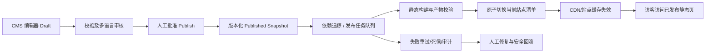

# OPCTools 国际工业品牌官网 UI 重构与 CMS 动态内容同步实施规范 V1.0

> 版本：V1.0 ｜ 日期：2026-10-09 ｜ 工作区：`H:\suns-New-code` ｜ 目标站点：`https://www.opctools.cloud`
> 状态：**设计已定稿**（六项决策已于 2026-10-09 逐条裁决并冻结，见 §12.1）；实现按 §8 切片推进
> 依据：`产品线路图.md`、`docs/待验收与遗留清单.md`、`docs/FRONTEND-INDUSTRIAL-2026-10-08.md`，以及本轮对 `packages/{ui,domain,publisher}`、`apps/{cms,web,worker}`、`database/001–029`、`_deploy/nginx/` 的**代码级核实**（三路只读侦察 + 主代理实跑基线）。
> **本规范每条现状判断都能定位到代码行**；未能核实的一律进 §附录 B，不写推测。

---

## §0 文档定位与红线（先读这一节）

### 0.1 读者与用途

| 读者 | 用途 |
| --- | --- |
| L2（会话主模型） | 按 §8 的切片顺序实现，按 §9 的命令逐条自验 |
| L1（Codex 终审） | §0.3 标注 🔴 的切片，按高风险属性做 diff 终审 |
| 运营 / 项目所有者 | 按 §5 查「改哪个字段 → 前台哪里变」，按 §6 理解发布后多久可见 |

### 0.2 三条不变量（任何切片都不得违反）

1. **不改 `tests/`**：本项目 `tests/` 由 L1 产出、L2 只读。唯一例外与程序见根 `AGENTS.md`「交付纪律」。
2. **不改已应用的迁移 `001`–`029`**：生产 `schema_migrations` 登记了 sha256，改文件会让 `migrate.mjs` 抛 `Applied migration changed` 并**中止发布**。要改就新增 `030+`。
   （注：根 `AGENTS.md` 写的「001–026」已过期，实际最新是 `029_add_inquiry_intent_scoring.sql`。）
3. **不改 DOM 契约与钩子**：`packages/ui/src/index.ts:19-27` 已用注释钉死三条硬约束 —— ① `tests/render.test.ts` 断言的类名（`hero-visual product-visual` / `hero-caption` / `home-collection` / `home-product-image` / `data-slide-count` / `data-pause` / 每页恰好一个 `<h1>`）；② `site.js` 依赖的选择器（`.inquiry-form`、`[data-rfq-list]`、`[data-rfq-add]`、`.product-actions` 的**紧邻兄弟节点**、`[data-home-filter]`、`[data-home-products]`、`[data-carousel]`、`[data-trade-public]`、`.search-form + .search-results`、`.service-widget`、`[data-analytics]`、`.file-field`）；③ kiln 里没有的组件用附加类、样式集中在 kiln-extra 段。

### 0.3 风险标记

| 标记 | 含义 |
| --- | --- |
| 🟢 | 低风险：样式、文案、后台标签、内部重构 → 自审 + `pnpm test` 兜底 |
| 🟡 | 中风险：影响公开站 DOM / 静态产物结构 → 需真机截图 + 生产内容探针 |
| 🔴 | 命中本项目高风险清单（`AGENTS.md` §3）→ **实现完成时必须单独出 L1 送审稿** |

---

## §1 结论摘要

### 1.1 方向已定，与「不推倒重建」不冲突

采用 **国际工业品牌（International Industrial Corporate）** 方向。核实后确认：**本项目已是「单一渲染器 + 单一设计系统」架构，不需要系统级重建**。改造点是三处：

| 改造点 | 现状 | 本规范要求 |
| --- | --- | --- |
| 设计令牌与尺寸基线 | 完整 token 体系（`packages/ui/src/kiln.css` 的 `:root`），但**用户给的四个色值一个都不存在** | **改值不改名**：换色、加 CTA 橙、调间距与网格 |
| 首页的地位与顺序 | 首页是**发布器自动生成的 system 文档**，body 固定四块；顺序硬编码 | **首页实体化** + 改「按块顺序渲染」+ 新增 3 个块类型 |
| 后台编辑 → 前台生效闭环 | 预览/发布/回滚齐全；但首页**不在后台可编范围内** | 补 4 处缺口，见 §7 |

### 1.2 五个必须纠正的认知（否则实施会走偏）

**① 「橙色 CTA」不能靠改 `--ember` 实现。**
`--ember` 在样式源里被引用 **24 处**，绝大多数**不是** CTA：眉标 `.caps`、卡片分类 `.card-cat`、筛选 `.filters button[aria-pressed]`、分页 `.pager`、时间线、FAQ 符号、引用左边框……
**正确做法**：`--ember` 保持蓝色语义（改为 `#1565A8`），**新增** `--cta` / `--cta-hover` 令牌，只挂到 `.btn-ember`（CTA 按钮）与 `.nav-cta > .btn-ember`（顶栏询价入口）。否则全站眉标一起变橙。

**② 设计系统不需要「升级」，它已经是模板系统。**
首页、`/{locale}/products[/page/N]`、产品详情、分类页、企业介绍、文章、`/{locale}/contact`、`/{locale}/search` 全部由 `bodyHTML()`（`packages/ui/src/index.ts`）渲染，输出同一份 `/assets/site.css` + `/assets/site.js`。用户要的「六类页面统一设计系统」**在架构上已经成立**；要做的是让视觉与尺寸达标。

**③ 用户给的关键色值在当前代码里一个都不存在。**
`grep` 全仓（`packages/ apps/ tests/ infrastructure/ database/ docs/ _deploy/ static-site/`，大小写均试）：**`#0B2545` / `#1565A8` / `#F28C28` / `#F5F7FA` 零命中**。现行最接近的是 `#0D2D47`（hero 底 / `theme-color`）、`#082238`（footer 底）、`#006BA6`（强调蓝）、`#F3F7FA`（浅底）。本规范 §3.1 给的是**一次性换值**，不是「微调」。

**④ 首页不在后台可编范围内 —— 这是最大的认知差。**
首页**不是** CMS 内容页，而是发布器在每次站级刷新时自动生成的 `system` 文档（`packages/publisher/src/index.ts:66`，route=`/{locale}`），body 固定为 `product_grid / case_studies / latest_articles / cta` 四块，`items` 由已发布快照现取（`:60` 的 `card()`）。
只有当**已有实体占用同一路由**时，发布器才跳过生成、由那条实体页接管（`:71` `if(paths.has(doc.route))continue`）。
⇒ 用户第四部分的「后台调整首页板块显示/隐藏与排序」「后台设置首页推荐产品」在当前结构下**根本无从下手**：那块内容不在后台，也没有编辑入口。**修法是「首页实体化」，见 §7.1，零 DDL。**

**⑤ 8 条后台要求里 6 条已具备，真缺口是 4 条（新增多语言缺口）。**
预览、发布记录、版本回滚、多语言内容与 SEO、发布后自动更新静态页、失败保留上一版 —— **全部已实现**（带行号证据，§6.3）。缺口：**首页可编（G0）**、**推荐产品选择器（G3）**、**分类板块与分类图（G1/G2）**、**首页市场块/GEO 块/统计同意只覆盖 zh+en（G7）**。

### 1.3 本轮实测基线（2026-10-09，含树上未提交的工业风改造）

| 检查 | 命令 | 实测结果 |
| --- | --- | --- |
| 单元测试 | `pnpm test` | ✅ exit 0：`# tests 99 / pass 97 / fail 0 / skipped 2` |
| 类型检查 | `pnpm -r typecheck` | ✅ exit 0，**6/6** 工作区 |
| 工作树 | `git status --short` | ⚠️ **5 文件未提交**（+603/−399）+ 1 个未跟踪文档 |
| CSS 产物一致性 | `.runtime/verify-css-fidelity.mjs` | ❌ **本机 `static-site/assets/site.css` 是旧皮肤**：含 `KILN`、不含 `#0D2D47`、不含 `.brand::before`（实测） |

**含义**：工业风改造已有一版在树上但**未提交、未验收**（`docs/FRONTEND-INDUSTRIAL-2026-10-08.md` 自记「验收：进行中」）。本规范把它视为进行中的 WIP，P0 在其基础上收口。

---

## §2 现状基线（代码级事实）

### 2.1 三个应用、两条对外服务路径

| 组件 | 位置 | 职责 |
| --- | --- | --- |
| CMS | `apps/cms`（Payload + Next，PM2 `suns-cms`，3001） | 后台、`/api/v1/**`、`/admin`、`/manage`、媒体 |
| Worker | `apps/worker`（PM2 `suns-worker`，**tsx 直接跑源码**） | BullMQ 消费发布、GEO 采样、定时调度 |
| Web | `apps/web`（Next） | 动态渲染同一份 `Document`（`dynamic='force-dynamic'`） |
| **静态产物** | `static-site/` | **nginx 直出，不过 Node** |

```
访客 → nginx → try_files $uri/index.html    ← 主路径：static-site 里的 HTML（生产 3053 个页面）
             └→ 未命中 → @resolve → /api/v1/resolve → CMS 回 301/302（仅路由搬迁）
```

- prod vhost 权威文件 = **`_deploy/nginx/opctools.cloud.conf`**（4452 B；文件头自述**手工放置、不在宝塔站点列表**，改后必须 `nginx -t && nginx -s reload`；`prod-deploy.sh` **只备份不部署**）。`infrastructure/nginx/default.conf` 是 **Docker 变体**（`root /usr/share/nginx/html`、upstream `cms:3001`），别拿它当生产。
- HTML 缓存头：`Cache-Control: public, max-age=0, s-maxage=600, must-revalidate` ⇒ 浏览器每次回源、CDN 最长压 600 秒。
- `/assets/` 缓存头：`public, max-age=300` ⇒ **`site.css` / `site.js` 有 5 分钟浏览器强缓存**，改样式后必须 `Ctrl+F5`。
- 静态产物**唯一写入口**是 `packages/publisher/src/files.ts` 的 `writeAtomic`，只被 `writeDocument`、`refreshSite` 调用，而唯一调用者是 `processPublishJob`（`:102/:105`）⇒ **改了 `packages/ui` 后不跑发布/重建任务，磁盘上的 HTML/CSS 不会变。**

### 2.2 设计系统现状（`packages/ui/src/kiln.css` 的 `:root`）

| 令牌 | 现值 | 用途 |
| --- | --- | --- |
| `--char` | `#FFFFFF` | 页面底色 |
| `--char-2` / `--char-3` | `#F3F7FA` / `#E8F0F6` | 浅底 |
| `--ember` | `#006BA6` | **语义=强调蓝**，24 处引用（**不是 CTA 色**） |
| `--glow` | `#005A8C` | 深一档强调蓝（hover、focus 环） |
| `--kiln` | `#DCEAF3` | 淡蓝装饰 |
| `--ash` | `#142B41` | **主文字色 / 深色块**，28 处引用 |
| `--hair` / `--hair-2` / `--hair-line` | `rgba(20,43,65,.13 / .07)` / `#E3EBF0` | 三级描边 |
| `--muted` / `--ink` | `#526579` / `#30475B` | 次级 / 正文文字 |
| `--sans` | `Bahnschrift, DIN Alternate, Aptos, Segoe UI, PingFang SC, Microsoft YaHei` | 主字体（**无 Inter**） |
| `--pad` | `clamp(1.25rem,4vw,3.5rem)` | 容器左右留白 |
| `--nav-h` | `clamp(62px,7vw,76px)` | 顶栏高度 |
| 缺失 | — | **没有间距/圆角/阴影 token**：圆角是字面量（`.btn` 3px、`.card` 4px），阴影全是字面量 |

**关键尺寸现状**：

| 项 | 现值 | 位置 |
| --- | --- | --- |
| 容器最大宽 | `1320px`（**所有断点都不改它**） | `kiln.css` `.wrap` |
| 板块上下间距 | 通用 `clamp(3rem,5vw,4.5rem)` = **48–72px**；**首页固定 64px**；≤880 首页 44px | `.section` / `.home-page>.section` |
| 通用网格列数 | 桌面 **4** 列、gap 22px（企业版覆盖基线 3 列/gap 1px） | `kiln-extra` `.grid` |
| 首页产品区列数 | 桌面 **3** 列、gap 24px | `.home-collection .grid` |
| 网格断点 | `1120 → 3 列`、`880 → 2 列`、`560 → 1 列` | `kiln-extra` |
| 断点全集 | `min-width:1121` / `1120` / `880` / `640` / `560` / `380`（+2 个 `prefers-reduced-motion`） | `styles.ts` 18 处 `@media` |
| Hero | `.hero-in{min-height:470px; gap:56px; padding-block:52px}`；**实测整块 588px** | `kiln-extra` / `after.json` |
| Hero 底 | `#0D2D47`，白字，局部覆盖 `--ember:#70C9F5`、`--muted:#BCD0DE` | `kiln-extra` |
| Hero 图 | 桌面 `16/10`（移动 `16/9`、≤560 `4/3`） | `kiln-extra` |
| 卡片图 | `.card-art, .home-product-image{aspect-ratio:4/3}`（基线是 `1/1`，被企业版覆盖） | `kiln-extra` |
| 产品详情主图 | `.pd-art{aspect-ratio:4/3}` | `kiln-extra` |
| 按钮热区 | `.btn{min-height:44px}` ✅ 已满足移动端 | `kiln-extra` |
| 轨道钉法 | `.card-art,.home-product-image,.pd-art,.thumbs button{grid-template-columns:minmax(0,1fr);grid-template-rows:minmax(0,1fr)}` | `styles.ts:1423` |

### 2.3 实测板块高度（1440px 视口，**生产内容**）

来源：`.runtime/industrial-ui/{before,after}.json`。这是 §3 尺寸要求的**依据**，不是估计。

| 板块 | 改造前 | WIP 后 | 用户要求的量级 |
| --- | --- | --- | --- |
| Hero | 601 | 588 | 桌面 600–720 |
| 信任带 creds | 202 | **100** | — |
| 整页头 page-head | 394 | 合并进 collection | — |
| 产品区 collection | **1302** | **1085** | — |
| 企业介绍 intro | 无 | 296 | — |
| 流程 process | 514 | 449 | — |
| 文章 articles | 584 | 493 | — |
| 市场块 trade | 352 | 311 | — |
| 结尾 close | 389 | 325 | — |

**读法**：WIP 已把产品区 1302→1085、信任带 202→100，方向正确；Hero 588 仍在 600 下沿之下，本轮要补。

### 2.4 CMS 可编辑面

| 后台分组（`page.tsx:41`） | 主要表 | 前台影响 |
| --- | --- | --- |
| 内容结构 | `content_items` / `content_item_translations` / `content_blocks` | 内页与文章正文、区块 |
| 产品结构 | `products` / `product_translations` / `product_media` / `product_spec_values` | 产品卡、详情、参数表 |
| 首页与客服 | `hero_slides` / `hero_slide_translations` / `menus` / `menu_items` / `customer_service_channels` | Hero、导航、客服浮层 |
| 搜索优化 | `seo_metadata` / `geo_profiles` / `schema_markup` / `redirects` / `robots_rules` | meta / hreflang / JSON-LD |
| 系统设置 | `site_settings` / `site_setting_translations` / `locales` | 站点名、域名、公司介绍、邮箱、语言 |

- 主入口 `primary`（`page.tsx:22-40`）**共 17 项**，其中**没有「首页」**；`appearance` 分组只含轮播/导航/客服。
- 通用 CRUD 走 `/api/v1/records`（`crud.ts` 的 `list/save/remove/restoreRevision`），**软删**并自动生成 `unpublish` 任务。
- ⚠️ **`content_blocks` 与 `body` 的优先级陷阱**：内页渲染时，若该译文存在**启用中的** `content_blocks` 行，则 `content_item_translations.body`（jsonb）被**完全忽略**（`documents.ts:28` `if(blocks.length) body=blocks`）。而后台区块编辑器写的是 `body`（`page.tsx:163-164`）。翻译流程已知此坑并做了保护（`translation.ts:213-214` 覆盖草稿后主动 `is_enabled=false`），但**手工编辑没有同等保护** ⇒ 必须先在目标库核查，见 §7.1。

---

## §3 设计规范（Design Tokens & Layout V1）

> 原则：**改值不改名**。24 处 `var(--ember)`、28 处 `var(--ash)`，改名会造成大面积回归；改值可让全站一致更新。

### 3.1 色彩

| 语义 | 令牌 | 现值 | **V1 目标值** | 说明 |
| --- | --- | --- | --- | --- |
| 主色（深） | `--ash` | `#142B41` | **`#0B2545`** 深海蓝 | 正文 + 深色块；白底对比度提升 |
| 强调蓝 | `--ember` | `#006BA6` | **`#1565A8`** 工业蓝 | 眉标/筛选/分页/激活态；**不是 CTA** |
| 强调蓝·深 | `--glow` | `#005A8C` | **`#0F4C7E`** | hover、focus 环 |
| **CTA** | `--cta` 🆕 | — | **`#F28C28`** | **新增**，只挂询价按钮 |
| CTA·hover | `--cta-hover` 🆕 | — | **`#C96A12`** | 新增；hover 底色（加深档） |
| CTA 文字（常态） | `--cta-ink` 🆕 | — | **`#0B2545`** | 新增；橙底上的深蓝字（≈6.5:1，达 AA） |
| CTA 文字（hover） | — | — | **`#FFFFFF`** | 反白（hover 底 ≈4.8:1，达 AA） |
| 深底 | `#0D2D47`（字面量） | `#0D2D47` | **统一到 `#0B2545`** | hero/close/footer 现在用的是字面量，不是 token |
| 背景 | `--char` | `#FFFFFF` | 保持 | — |
| 浅底 | `--char-2` | `#F3F7FA` | 保持（≈用户给的 `#F5F7FA`） | 同色系，不折腾 |
| 描边 | `--hair*` | `rgba(20,43,65,…)` | **跟随 `--ash` 改基色** → `rgba(11,37,69,…)` | 描边与主色同源 |

**⚠️ 对比度告警（已按裁决处理）**：`#F28C28` 上的白字对比度约 **2.6:1**，低于 WCAG AA（正文 4.5:1 / 大字 3:1）。三方案：
- A. 深蓝字 + 橙底 → 约 **6.5:1** ✅
- **B（已采纳）**：常态深蓝字 + 橙底（≈6.5:1）；**hover 时**底色加深到 `--cta-hover` 并反白（深底 + 白字 ≈ 4.8:1，仍达 AA）✅
- C. 保持白字，把橙加深到 `#C96A12`（牺牲用户指定色）❌ 未采纳

> **Q1 已裁决 = B**：`--cta-ink: #0B2545`（常态文字色），hover 反白 `#FFFFFF`。详见 §12.1。

**不能碰的**：`.btn-ember` 现有渐变 `linear-gradient(120deg,#0076B8,#005A8C)`+`box-shadow` 是品牌标识位；换橙时**保留渐变结构**，只换色标与阴影 rgba。

### 3.2 字体与字号阶梯

| 角色 | 现值 | V1 |
| --- | --- | --- |
| 正文族 | `--sans`（Bahnschrift 优先） | 保持；是否引入 Inter 见 §12 Q2 |
| 正文大小 | `clamp(.95rem,.32vw+.88rem,1.02rem)` | 保持 |
| Hero H1 | 企业版覆盖为 `clamp(2.2rem,3.7vw,3.55rem); weight:600; letter-spacing:-.035em; max-width:20ch` | 保持 |
| 内页 H1 | `.page-head h1{clamp(1.85rem,3vw,2.75rem); weight:600}` | 保持 |
| H2 板块 | `.h-sec{clamp(1.7rem,2.6vw,2.5rem); letter-spacing:-.025em}`（企业版覆盖） | 保持 |
| 眉标 `.caps` | `.75rem / .12em / uppercase / 600`（企业版覆盖） | 保持 |
| 引导句 `.lede` | `1rem / line-height 1.8 / max-width 58ch` | 保持 |

### 3.3 栅格与容器

| 项 | 现值 | V1 决策 |
| --- | --- | --- |
| 内容最大宽 | **1320px** | **改 1360px**（用户 1280–1440 的取值） |
| 左右留白 | `--pad` | 保持 |
| 列体系 | CSS Grid，非 12 列 | **不引入 12 列框架**：现有 Grid + `minmax(0,1fr)` 已达标，引入即 scope 膨胀（§10） |

> 1320 → 1360 会让**所有页面横向多 40px**，此前记录的像素基线（`before.json` / `after.json`）整体失效，**必须重新量基线**（§9 V6）。

### 3.4 间距阶梯

| 位置 | 现值 | V1 目标 |
| --- | --- | --- |
| 通用 `.section` | `clamp(3rem,5vw,4.5rem)` = 48–72px | **64–88px** → `clamp(4rem,5.5vw,5.5rem)` |
| 首页 `> .section` | **固定 64px** | **已裁决（Q3）**：与通用段统一为 `clamp(4rem,5.5vw,5.5rem)` |
| ≤880px 所有 | 44px | **40–56px** → `clamp(2.5rem,5vw,3.5rem)` |
| `.section--tight` | `padding-top:0` | 保持（相邻板块视觉归组） |

### 3.5 断点（**建议不采用用户给的 1440/1200/992/768/480**）

**理由**：现有断点 `1120/880/640/560/380`（+ `min-width:1121`）已覆盖 9 语言 × 真实内容，并通过宽度矩阵探针（`.runtime/industrial-ui/verify.mjs` 测 320/390/768/1024/1440）。一次性换新断点会**重排全部页面**（6 类模板 × 9 语言），收益只是「数字好看」。

**推荐映射表**（用现有断点满足用户意图）：

| 用户断点 | 意图 | 现有实现 | 结论 |
| --- | --- | --- | --- |
| 1440 | 大屏加大容器 | `.wrap` 1360px | ✅ 满足 |
| 1200 | 4 列 → 3 列 | 现有 1120 → 3 列；**新增 1200** 更贴近 | 🟢 增量 |
| 992 | 3 列 → 2 列 | 现有 880 → 2 列；**新增 992** 更贴近 | 🟢 增量 |
| 768 | 2 列 → 1 列 | 现有 560 → 1 列 | **已裁决（Q4）**：**不新增 768 断点**，平板保持 2 列 |
| 480 | 小屏 | 现有 380 专门规则 | 保持 |

### 3.6 组件规格（对应用户第三部分）

| 组件 | 用户要求 | 现值 | V1 动作 | 风险 |
| --- | --- | --- | --- | --- |
| 全局容器 | 1360px | 1320 | 改 `.wrap` | 🟡 |
| 板块间距 | 桌面 64–88 / 移动 40–56 | 通用 48–72 / 首页 64 / ≤880 44 | 改通用 `.section` | 🟡 |
| 产品卡片列数 | 桌面 4 | 首页 **3** / 通用 4 | **首页产品区改 4 列** | 🟡 |
| 产品主图比例 | **1:1** | 4:3（基线是 1/1，被企业版覆盖） | **已裁决（Q5）**：`.card-art`、`.home-product-image` 改 `1/1` | 🟡 |
| 分类图比例 | 4:3 | **分类无图字段** | §7.3（需迁移） | 🔴 |
| Hero 高度 | 桌面 600–720 | 588 | `.hero-in` `min-height:470 → 520`（整块 ≈ 640） | 🟡 |
| 卡片等高 | 同行对齐 | `.card-body{flex:1}` 已有；轨道已钉 | 保持（WIP 已修过「图片放大裁切」） | 🟢 |
| 按钮热区 | 移动 ≥44px | `.btn{min-height:44px}` ✅ | 保持 | 🟢 |

**必须记住的坑**：`.card-art / .home-product-image / .pd-art / .thumbs button` 是 `aspect-ratio + display:grid + place-items:center`，**必须显式声明 `grid-template-columns/rows: minmax(0,1fr)`**，否则 auto 轨道被图片固有宽度撑开，`img{width:66%}` 解析成「轨道宽 × 66%」而溢出被裁（2026-10-02 实测：430px 卡片里图被放大到 792px）。改比例时**同时检查这条**（现行钉法在 `styles.ts:1423`，另 `picture{display:contents}` 在 `:1211`）。

### 3.7 图片规格

| 位置 | 比例 | 说明 |
| --- | --- | --- |
| 产品主图（卡片） | **1:1** | `object-fit:contain`，底 `#F5F8FA`，不裁切实物 |
| 产品详情主图 | **保持 4:3**（已裁决 Q5） | 现 `.pd-art{4/3}`；规格段还有内联 `style="aspect-ratio:4/3"`（`index.ts:138`） |
| 分类图 | 4:3 | 需新增字段（§7.3） |
| Hero 图 | 16:10 / 移动 16:9 / 小屏 4:3 | 保持 |
| 变体 | `media_variants` 按宽度生成，`<picture>` 输出 avif/webp + 宽描述符 | 保持（`index.ts:61` 的 `image()`） |

### 3.8 SEO / 无障碍硬要求（不得回退）

- **每页恰好一个 `<h1>`**（`tests/render.test.ts:19,29` 双断言）；Hero 第 2 张 slide 起用 `<h2>`。
- `hreflang` + `x-default` + canonical 由 `renderHTML()` 输出，9 语言全量。
- `noindex,follow` 出现在 `enable_indexing=false` 或 `robots_index=false` 时。
- 全部行为**无 JS 可用**（`browser.ts:6` 纪律①）。
- 导航高亮依赖 `menu()` 的 `aria-current="page"`，改导航 HTML 时别丢。

---

## §4 页面模板矩阵

| 页面 | 生成方式 | 渲染入口 | 本次 |
| --- | --- | --- | --- |
| **首页 `/{locale}`** | **发布器自动生成的 system 文档**（`publisher/index.ts:66`）；若已有实体占用同路由则**由该实体页接管**（`:71`） | `hero()` + `homepage()` | ✅ 主战场 |
| 产品列表 `/{locale}/products[/page/N]` | 发布器自动（每页 24，`publisher:67`） | `block('product_grid')` | ✅ 尺寸/比例 |
| 产品详情 `/{locale}/products/<slug>` | CMS 产品译文 | `productLead()` + `contact_form` | ✅ 尺寸/比例 |
| 分类页 `/{locale}/<term-path>` | CMS 分类译文 | `pageHead` + `related` 产品网格 | ✅ 加分类图 |
| 企业介绍 `/{locale}/about` | CMS 内容页 | `block()` | 🟢 |
| 文章 `/{locale}/<article-path>` | CMS 内容页 | `block()` | 🟢 |
| 联系 `/{locale}/contact` | 发布器自动（`publisher:68`） | `contact_form` | 🟢 |
| 搜索 `/{locale}/search` | 发布器自动（`publisher:69`，强制 `robots_index=false`） | `search` 块 | 🟢 |
| 客户/渠道门户 | `/api/v1/trade-public/portal-page` | `tradePortalHTML()`（独立壳，自带 CSS/JS） | 🟢 不动 |

> 自动生成的系统页（首页兜底/列表/联系/搜索）**运营改不了内容**，只能改样式与块类型行为。

---

## §5 首页 10 板块 × CMS 字段映射

> 「后台可编辑」= 运营能在 `/manage` 改并让前台变。❌ 表示当前做不到，指向 §7 的缺口编号。

| # | 板块 | 渲染函数 | 数据来源 | 后台入口 | 现状 |
| --- | --- | --- | --- | --- | --- |
| 01 | Header 导航 | `bodyHTML` + `menu()` :210-221 | `menus` / `menu_items` / `menu_item_translations`；语言切换用 `d.alternates`；站点名 `site_settings.site_name` + `site_setting_translations.site_title` | 首页与客服 → 导航菜单/项目/翻译；系统设置 → 站点信息 | ✅ 可编辑 |
| 02 | Hero Banner | `hero()` :141-153 | `hero_slides`(desktop/mobile media, sort_order, duration_ms, text_position, overlay_opacity, is_enabled, start_at/end_at) ⋈ `hero_slide_translations`(title, subtitle, description, primary/secondary button 文案与链接) | 首页与客服 → 首页轮播 / 轮播翻译 | ✅ 可编辑。⚠️ 每张图**必须至少有一种语言的译文**，否则该图完全不显示（内连接，`documents.ts:11`；后台已有告警） |
| 03 | **产品分类** | ❌ 首页无此板块 | `taxonomy_terms` / `taxonomy_term_translations`（**无图片字段**） | 内容结构 → 分类 / 分类翻译 | ❌ **缺板块 + 缺分类图** → **G1 / G2** |
| 04 | Featured Products | `homeCollection()` :155-168 | 首页 `product_grid` 块的 `data.items`（自由 JSON 快照，无 FK）；**当前由发布器写死 `products.slice(0,6)`**（`publisher:66`）；内页为空时自动填（`publisher:62`，带 `_autoItems` 标记） | ❌ **首页无编辑入口** → G0；另无产品选择器 → **G3** | ⚠️ 见 §7.1/§7.4 |
| 05 | About Company | `intro` :181-182 | `site_setting_translations.company_description` → 兜底 `footer_description` | 系统设置 → 站点翻译 | ✅ 可编辑（单段富文本）；生产实为空（内容缺口，非代码） |
| 06 | **Manufacturing Capability** | ❌ 无专用板块 | 可用现有块拼：`image_text` / `rich_text` / `statistics` / `timeline` | 内容结构 → 页面区块 | ⚠️ 无专用板块、无结构化设备/产能字段 → **G4** |
| 07 | **Quality & Certifications** | ❌ 首页无板块 | **数据已存在**：`trade_market_cards`，`kind='certificate'`（`database/023:40`；schema `trade-operations.ts:55`），服务端函数 `publicTradeCards(locale, market)`（`:62`） | 外贸业务 → 04 采购信任与服务 | ⚠️ **只在「市场与采购」块里由 JS 拉取，且必须先选市场**；证书有 `valid_until` 过期停展、发布需**另一位审核员**（`changeMarketCard :58`） → **G5** |
| 08 | Applications | `application_grid` 块 :195 **或** 首页产品区的应用筛选（`homeCollection` :158-159） | 块 `data.items`（手填）；筛选标签来自产品 `product_translations.applications`(jsonb) | 内容结构 → 页面区块；产品结构 → 产品 | ⚠️ 两条路径都靠手填/间接 → 并入 **G3** |
| 09 | News & Insights | `posts()` :80-86 + `latest_articles` 块 | 块 `data.items`；内页为空时发布器自动填（`publisher:62`，取 article/guide/case_study） | 内容结构 → 页面与文章 | ✅ 可编辑 |
| 10 | RFQ + Footer | `contact_form` 块（`inquiry()` :95-110 + `inquiryList()` :111）+ footer | `site_settings`(company_email/phone) + `customer_service_channels` + footer 的 `menu_items`；表单字段文案来自 `tradeText()` | 首页与客服 → 客服渠道；系统设置 → 站点信息 | ✅ 可编辑；RFQ 清单本地持久化 + 多产品询价（V3.1） |

### 5.1 现状渲染顺序（**这是 G0 的实体，必须改**）

`index.ts:187` 实际输出顺序与**出现条件**：

| # | 板块 | 条件 |
| --- | --- | --- |
| 1 | `<section class="creds">` 信任带 | **恒有**；条目 = 代码常量 `homeWords[locale].proof`（3 条）+ 有邮箱/电话时 1 条，`slice(0,4)` |
| 2 | `home-collection` 产品区 | 仅当 `product_grid` 块 `data.items` 非空；最多 6 张卡、筛选标签最多 5 个 |
| 3 | `company-intro` 企业介绍 | 仅当有 `company_description \|\| footer_description` |
| 4 | **remaining** 其余块 | `body` 中不属于 `[product_grid, latest_articles, case_studies]` 且 `type!=='cta'` 的块，**保持数组顺序** |
| 5 | `process` 采购流程 | **恒有**；文案来自代码常量 `tradeText` 的 `process/processTitle/step1-3` |
| 6 | cases | 仅当 `case_studies.data.items` 非空 |
| 7 | articles | 仅当 `latest_articles.data.items` 非空 |
| 8 | `trade-section` 市场与采购 | **恒有**（卡片网格初始为空，由 JS 填） |
| 9 | closing CTA / `closeBlock` | 有 `cta` 且 `data.title` 非空则逐个渲染；否则渲染 `closeBlock(d)` |

**冲突点**：2/6/7 是「按类型捞取后钉死位置」，运营的数组顺序对它们无效；1/5/8 完全由代码决定，运营既不能关也不能挪。

---

## §6 发布链路规范（CMS 编辑 → 静态页 → 访客）

### 6.1 完整链路（已核实）

| # | 阶段 | 实现 | 关键位置 |
| --- | --- | --- | --- |
| 1 | **后台编辑** | `/manage` 表单写库；区块数组写进 `content_item_translations.body`（jsonb），或 `content_blocks` 行 | `page.tsx:163-164` |
| 2 | **提交时校验** | 权限 `publishing.write`/admin/reviewer；`REPEATABLE READ` + `FOR UPDATE`；**乐观锁**：`updated_at` 与快照不一致 → `409 内容已修改，请重新提交发布`；定时发布时间必须未来 | `publishing.ts:7,11,13,16` |
| 3 | **发布事件（只写 Postgres）** | 插入 `publish_jobs`（`metadata={snapshot,route}`）；定时任务把译文置 `scheduled`；写 audit。**CMS 不直接投 Redis** | `publishing.ts:17-19` |
| 4 | **Worker 消费** | worker **每 3 秒轮询 Postgres** 投递到 BullMQ（队列 `static-publish`，`concurrency:1`，`lockDuration:120s`）→ `processPublishJob`：`pg_advisory_lock(837611,1)` 串行化 → 认领 `pending/retrying/processing → processing`（`attempt_count+1`） | `worker:8,9,14,20`、`publisher:95-96` |
| 5 | **静态页生成** | `writeDocument()`：先算 sha256，与 `static_routes.checksum` 一致**且文件存在** → `skipped`（不写盘）；否则 `writeAtomic`（temp + rename） | `publisher:36-38`、`files.ts:6` |
| 6 | **站级刷新** | `refreshSite()`：写 `assets/site.css`+`site.js`；**孤儿清扫**（fail-closed，未列举的 entity_type 不退役）；disabled locale 清扫；逐文档重渲染；自动生成 `products/blog/contact/search` + **首页 system 文档**；重建 sitemap（每 45000 条一片）/robots/`_redirects.json`/`manifest.json`；全局 alternates 修剪 | `publisher:43-84` |
| 7 | **批量门控** | 只有「没有其它活动发布任务」时才做站级刷新（避免 O(N²)：实测 2567 任务批次曾从 284 条/小时退化到 53 条/小时，ETA 4h→26h+） | `publisher:12-33,104` |
| 8 | **缓存刷新** | `purge()`：两个 Cloudflare 变量都缺 → **静默跳过**；只配一个 → **抛错**（fail closed） | `publisher:85-92` |
| 9 | **前端展示** | nginx 直出 `static-site/**/index.html`；未命中才落 `@resolve` | `_deploy/nginx/opctools.cloud.conf` |

### 6.2 「失败保留上一版本」——**单文件成立，整批不成立**（重要澄清）

- ✅ `writeAtomic()` = 写 `file.uuid.tmp`（`flag:'wx'`）→ `rename`，**rename 原子**；任一步失败只 `unlink(temp)` 再抛，**旧 `index.html` 未被触碰**（`files.ts:6`）。
- ✅ 失败路径只更新 `publish_jobs.status='retrying'|'failed'` + `error_message`，**不删已生成路由**（`publisher:106`）。
- ⚠️ **但整条链路没有事务性回滚**：`writeDocument` 是「先写文件、后写库」，文件成功而 `static_routes` UPSERT 失败会留下「磁盘新、DB 旧」；`refreshSite` 逐文档循环无事务，中途失败会留下**混合版本**（已写的是新的、未写的是旧的），而 `skipped` 分支还会固化这种混合态。
- ⇒ 结论：**「发布失败导致官网白页」在当前实现下不会由发布失败引起**；但「一次批量刷新中途失败 → 站点部分新部分旧」是**真实存在**的中间态。回到上一公开版本只能靠 `rollbackPublished()`（§6.3）。

### 6.3 草稿预览、发布记录、版本回滚 —— **三条全部已实现**

| 能力 | 实现 | 证据 |
| --- | --- | --- |
| 草稿预览 + 差异 | `publishPreview(actor, table, id)`：`sourceDocument()` 取**草稿** 与 `published_documents` 快照逐字段比 `title/description/route/body/seo`；附 `revisions`（最近 **15** 条已完成发布）；接口 `GET /api/v1/v2/preview` **在返回体里附 `html: renderHTML(draft)`** | `seo-review.ts:47-55`、`v2-api.ts:57` |
| 预览是否影响线上 | **不影响**：只用 `renderHTML()`，**没有任何 `writeAtomic`/`outputRoot` 调用**；前端 `<iframe sandbox="" srcDoc>` 展示，文案即「预览禁用脚本。公开页面仍以发布任务完成后的静态文件为准。」 | `v2-api.ts`、`V2Workspaces.tsx:29` |
| 发布记录 | `publish_jobs`（状态 `pending/processing/completed/failed/retrying/cancelled`；`job_type` `publish/unpublish/rebuild/sitemap/cdn_purge`）+ `publish_job_routes` 逐路由状态 | 后台「发布记录」 |
| 版本回滚 | `rollbackPublished(actor, jobId)`：取历史已完成 publish job 的 snapshot → **新建一条 publish job**（`metadata.rollbackOf`）；**不动历史行**；路径变了拒绝（`网址已更改；请先检查路径后重新发布`）；**写审计** `rollback.requested`；前端按钮「恢复此公开版本」+ confirm | `seo-review.ts:57-70`、`v2-api.ts:58`（202） |
| 另一条**不同**的「恢复」 | `POST /api/v1/restore` → `restoreRevision()`：从 `content_revisions` 还原**草稿**（强制 `status='draft'`），**不入队、不影响公开站** | `crud.ts:73-76` |

> 用户第四部分的 8 条要求中，**第 5/6/7/8 条已全部具备**。缺第 1/3/4 条（§7），并新增发现第 2 条的分类图与多语言缺口。

### 6.4 可见性 SLA（写给运营）

| 场景 | 生效时间 |
| --- | --- |
| 单条内容发布 | worker 3 秒轮询 + 生成 + 站级刷新，通常**秒级到数十秒** |
| CSS / JS 改动 | 需**全站重建**；浏览器 5 分钟强缓存 ⇒ 访客 **`Ctrl+F5`** 才必定看到 |
| 批量发布（数百条） | 站级刷新被**门控推迟**，列表/首页/sitemap 可能滞后；`PUBLISH_REFRESH_MAX_DEFER_MS`（默认 300000ms）**不是 wall-clock SLA** —— 只在「有新任务经过门控」时才检查；**最后一个任务失败/取消/死信且再无任务时，站级产物不会自己刷新** |
| CDN | 未配置 Cloudflare 时 `purge()` 静默跳过 |

---

## §7 后台能力差距清单与实现方案

### 7.1 G0（🔴 P0）让首页可编：首页实体化 + 按块顺序渲染

**现状（两条硬事实）**
1. 首页是 `refreshSite` 生成的 `system` 文档（`publisher:66`），body 固定 `product_grid / case_studies / latest_articles / cta`，`items` 每次现取；**后台没有任何编辑入口**。
2. `homepage()` 把 `product_grid / latest_articles / case_studies / cta` **按类型捞取后钉死位置**（`index.ts:172-176,187`），`creds` 与 `process` 完全由代码决定。

**最小实施（分两步，第一步零代码）**

**步骤 1（零代码、零 DDL）：为 9 种语言各建一条首页内容页 `path=/{locale}` 并发布。**
- 可行性已核实：`guard_site_path()` 明确允许 `NEW.path = '/'||locale_code`（`database/011_runtime.sql:22`），`/en` 合法；`published_documents` 主键是 `route`，实体行会用 `ON CONFLICT(route) DO UPDATE` 自然替换旧的 system 行；`refreshSite` 对已被实体占用的路由 `continue`（`publisher:71`），不会互相覆盖。**顺序上实体先 store、system 后判 skip，实体必胜。**
- 效果：首页立刻变成「后台可编的内容页」（含区块排序、显示/隐藏、正文块），且**保留** `hero()` 与 `homepage()` 的现有版式（`bodyHTML` 用 `d.route==='/'+d.locale` 判首页）。
- 风险控制：先做 **1 种语言（建议 en）试点**，用预览（`v2 preview`）比对再决定其余 8 种。

**步骤 2（代码）：把「代码决定的板块」变成真实块类型。**

| 现在 | 改成 | 说明 |
| --- | --- | --- |
| `creds` 信任带（`homeWords.proof` 代码常量） | 新块类型 **`trust_bar`**，`data.items[]` 由运营填 | 承载「制造能力/市场」等信任点 |
| `process` 三步（`tradeText` step1-3 代码常量） | 新块类型 **`process_steps`**，`data.items[]` | 承载采购流程 |
| `homepage()` 的「按类型捞取后钉死」 | **一次遍历 `d.body` 按数组顺序渲染**；仅 `product_grid` 保留 `homeCollection()` 专用版式，其余走 `block()` | 排序/隐藏立即生效 |
| `closeBlock()` 兜底 | 仅在**没有任何 `cta` 块**时兜底 | 保持现有语义 |
| `BlockEditor` 无显示/隐藏 | 每块加 **显示/隐藏开关** | 排序已有（↑/↓） |

**⚠️ 两个必须先做的核查（否则步骤 2 会踩坑）**
- **核查 A（数据）**：`SELECT content_translation_id, count(*) FROM content_blocks WHERE is_enabled GROUP BY 1;` —— 若首页译文已有启用中的 `content_blocks`，则后台改 `body` **静默无效**（`documents.ts:28`）。处置二选一：**(a) 区块编辑器直接写 `content_blocks`（推荐**，`is_enabled`/`sort_order` 是结构列，正是「显示/隐藏/排序」所需）；(b) 把 `content_blocks` 回填进 `body` 后停用块表路径。
- **核查 B（零 DDL 前提）**：`content_blocks.block_type` 是 `text NOT NULL` 且**无 CHECK 约束** ⇒ 新增 `trust_bar`/`process_steps`/`certifications` 等类型**不需要迁移**（`FRONTEND-RESKIN.md:38` 已记录同一结论）。

**风险**：🔴 —— 改变公开站**每个内容页**的板块渲染路径（高风险清单第 4 条邻域）。
**L1**：**必须送审**（切片 S1）。

### 7.2 G1（🟢 P0）新增「产品分类」板块

- **现状**：首页无分类板块；`category_grid` 块类型**已存在**（`BlockEditor.tsx:3`），渲染走 `cards()`（`index.ts:195`），但 `items` 需手填，**publisher 不会自动填充**（`:62` 只处理 `product_grid` / `latest_articles`）。
- **最小实施**：在 `publisher:62` 的自动填充分支加入 `category_grid → taxonomy_term_translations`（复用 `card()` 的字段形状：`route`/`title`/`description`/`media`）。前端 `cards()` 已能渲染带图卡片，无需新函数。
- **风险**：🟢。**L1**：不需要。

### 7.3 G2（🔴 P1）分类图字段（**本规范唯一必须新增迁移的一项**）

- **现状**：`taxonomy_terms` 列为 `id, taxonomy_id, parent_id, code, sort_order, is_enabled, created_at, updated_at, deleted_at` —— **没有任何图片字段**。用户要求「分类图 4:3」，无处可取。
- **最小实施（新增 `030_taxonomy_featured_media.sql`）**：
  ```sql
  ALTER TABLE taxonomy_terms ADD COLUMN featured_media_id uuid;
  ALTER TABLE taxonomy_terms ADD CONSTRAINT fk_terms_featured_media
    FOREIGN KEY(featured_media_id) REFERENCES media_assets(id) ON DELETE SET NULL;
  ```
  - 回滚 `database/rollback/030_*.down.sql`：`DROP CONSTRAINT` + `DROP COLUMN`（**纯加列、可逆、不删数据**）。
  - `field-meta.ts` 必须补 `fieldLabels.featured_media_id = '分类主图'`（否则后台直接暴露英文列名 —— 本项目既有踩坑）。
  - `documents.ts` 组装分类文档时 join `media_assets` 生成 `media[0]`。
  - 运营侧：每张分类图都要为 9 语言填 alt（否则 SEO 诊断报 warning，`seo-review.ts:40`）。
- **风险**：🔴 命中高风险清单第 1 条（DB schema 与迁移）。只加不删、带回滚、不改 001–029。
- **L1**：**必须送审**（切片 S3）——送审材料 = 迁移 + 回滚 + `verify.mjs --local-runtime` 全链路 exit 0 的证据。

### 7.4 G3（🟡 P0）首页推荐产品的可视化选择

- **现状**：**没有 `is_featured` / `recommend` 字段**（全仓 `grep featured` 只命中 `featured_media_id`＝主图外键）。首页产品集合唯一来源是 `product_grid` 块的 `data.items`（自由 JSON 快照，无 FK）；后台 `BlockEditor` 对 `product_grid` 的 items **只有 `title/text/url/image` 四个文本框**（`BlockEditor.tsx:4,11`），没有产品选择器。
- **最小实施（零 DDL，推荐）**：给 `BlockEditor` 的 `product_grid` / `application_grid` / `category_grid` 的 items 增加**选择器**：输入 SKU 或标题 → 调后台已有的 `records` / `reference-labels` 接口 → 自动填入 `title` / `url` / `image`。运营不再手抄 URL。
- **备选（需 DDL，不建议本轮做）**：`products` 加 `is_featured` + `featured_sort_order`，发布器按它填充。**更「像 CMS」，但多一次迁移 + L1 终审，收益边际**。
- **风险**：🟡（后台 UI + 读接口，不动公开站渲染）。**L1**：不需要（选备选方案则升级 🔴）。

### 7.5 G4 / G5（🟡 P1）制造能力与质量认证板块

- **G4 制造能力**：现状**无专表**。最小实施：**复用现有块类型**（`image_text` + `statistics` + `feature_grid`）组合，只补一个统一样式段（如 `.capability`）到 `kiln-extra` —— 遵守 `index.ts:26-27` 的纪律：**kiln 里没有的组件用附加类，集中在 kiln-extra 段，不往 kiln.css 混写**。**零 DDL、零新表**。
- **G5 质量与认证**：数据**已存在**于 `trade_market_cards`（`kind='certificate'`），经 `publicTradeCards()` 对外；现状只在「市场与采购」块里由 `site.js` 客户端拉取且必须先选市场。
  最小实施：新增服务端块 `certifications`，在 `refreshSite` 时由 publisher 用 `kind='certificate' AND status='published' AND (valid_until IS NULL OR valid_until > now())` 填充 `items`（**过期停展**的既定规则一并继承）。
  ⚠️ **不要新增对外 API 端点**（会命中高风险清单第 4 条）；只复用 domain 内查询。
- **风险**：🟡。**L1**：按建议做法不需要；若坚持新增对外端点则升级 🔴。

### 7.6 G6（🟢 P1）后台「首页」入口与区块级说明

- **现状**：`primary` 导航无「首页」；`resourceGuides`（`field-meta.ts:181-211`）覆盖 16 张表但**不含首页相关内容**。
- **最小实施**：完成 §7.1 步骤 1 后，在 `primary` 加「首页」直达项（指向那条 `path=/{locale}` 的内容页），并补 `resourceGuides` 条目：「改这里会动首页哪一块、改完要点发布、CSS 改动需全站重建」。
- **风险**：🟢。**L1**：不需要。

### 7.7 G7（🟡 P1）首页「市场与采购 / GEO / 统计同意」只覆盖 zh + en

- **现状（实测行号）**：`packages/ui/src/index.ts` 里有大量 `d.locale==='zh' ? 中 : 英` 的三元硬编码，**其余 7 种语言（de/fr/es/it/pt/ja/ko）一律回落英文**：
  - 询盘表单：`:102`（电话）、`:106`（选择文件 / 未选择任何文件 / PDF 或图片提示）
  - **市场与采购块**：`:234`（`MARKET & PROCUREMENT` **无任何语言变体**）、`:236`（选择采购目的地 / 通用资料）、`:237`（客户与渠道专属入口 / 申请渠道合作）、`:241-243`（空态 / 查看来源 / 有效至 / 错误文案）
  - **GEO 知识段**：`:252`（核心知识）
  - **统计同意**：`:268`（询问文案 / 允许 / 拒绝）、`:274`（统计偏好）
  - 另有 `defaultFooterLinks`（`:222`）是**内联 9 语言小词典**（说明正确做法可行）
- **最小实施**：把上述字符串迁到既有 9 语言表，移除三元硬编码。**落点与现状容量（实测）**：

  | 文案归属 | 目标表 | 现状 | 本切片要做的 |
  | --- | --- | --- | --- |
  | 询盘表单（电话 / 文件控件 / 提示） | `words.ts` 的 `words` | **每语言 17 条**（定长数组，索引 0-16，`t(d,i)` 取值） | 追加索引；9 语言各补 3-4 条 |
  | 市场与采购块 / GEO 段 / 统计同意 | `trade.ts` 的 `tradeText` | **每语言 27 条**（`copy[locale][key]→copy.en[key]→key` 三级回退） | 追加 ~12 个 key；9 语言各补 |
  | 首页专用词 | `words.ts` 的 `homeWords` | 每语言 1 个对象（`intro/introTitle/proof[3]/collection/collectionText/allProducts/craft/craftText/contact`） | 按需追加字段 |
  | 少量界面词 | `index.ts:30-40` 的内联 `extra` | **每语言 11 条**（`u(d,key)` 取值） | 可继续沿用或并入 `homeWords` |

  ⚠️ 现成的正确范例就是 `defaultFooterLinks`（`index.ts:222` 的内联 9 语言词典）—— 说明「一次性补 9 语言」是既有做法，不构成新机制。
- **风险**：🟡（`trade-public.ts` 的 JS 端通过 `data-*` 读取文案，改 HTML 属性值即可，不动选择器）。**L1**：不需要。
- **为什么重要**：用户的核心诉求是「多语言 SEO/GEO 官网」，而**首页的市场块与 GEO 块正是 SEO/GEO 的门面**，却是英文兜底。

### 7.8 需求 8 条逐条对照（总表）

| # | 用户要求 | 现状 | 缺口 | 切片 |
| --- | --- | --- | --- | --- |
| 1 | 后台调整首页板块的**显示/隐藏和排序** | `content_blocks.is_enabled`/`sort_order` 存在且装配层生效；但**首页是 system 文档、后台无入口**，且 `homepage()` 顺序硬编码 | **G0** | S1 🔴 |
| 2 | 后台修改**产品分类、产品图片、标题和描述** | 产品图片/标题/描述 ✅；**分类无图** | **G2** | S3 🔴 |
| 3 | 后台设置**首页推荐产品** | 靠手填 `data.items`，无产品选择器 | **G3** | S2 🟡 |
| 4 | 后台修改 **Banner、按钮文字及跳转链接** | ✅ `hero_slide_translations` 六字段齐全 | — | — |
| 5 | 后台管理**多语言内容及 SEO 元数据** | 后台与渲染 ✅（9 语言 + hreflang/canonical/JSON-LD）；但**首页三个块是 zh/en 硬编码** | **G7** | S6 🟡 |
| 6 | 内容发布后**自动更新对应静态页面** | ✅ 发布 → worker → 静态页 + 站级刷新 | — | — |
| 7 | 发布失败时**保留上一版本** | ✅ 单文件原子写；⚠️ 整批刷新中途失败会留混合版本 | — | — |
| 8 | **草稿预览、发布记录和版本回滚** | ✅ 三条全部实现（§6.3） | — | — |

---

## §8 改动文件清单与切片顺序

### 8.1 切片顺序

| 切片 | 内容 | 主要文件 | 风险 | 需 L1 |
| --- | --- | --- | --- | --- |
| **S0** | **收口现有 WIP**：提交树上 5 个未提交文件；跑通 §9 V1–V4 | `packages/ui/**`（已改） | 🟢 | 否 |
| **S1** | G0：首页实体化（试点 en）+ `homepage()` 改按块顺序 + `trust_bar`/`process_steps` 块 + BlockEditor 显示/隐藏 + **核查 A** | `packages/ui/src/index.ts`、`apps/cms/src/components/BlockEditor.tsx`、`apps/cms/.../page.tsx` | 🔴 | **是** |
| **S2** | G1 + G3：分类板块自动填充 + 产品选择器 | `packages/publisher/src/index.ts`、`apps/cms/src/components/BlockEditor.tsx` | 🟡 | 否 |
| **S3** | G2：`030` 迁移（分类主图）+ `field-meta.ts` + 分类文档组装 | `database/030_*.sql` + rollback、`apps/cms/.../field-meta.ts`、`packages/domain/src/documents.ts` | 🔴 | **是** |
| **S4** | G4 + G5：制造能力样式段 + 证书服务端块 | `packages/ui/src/kiln-extra.css`、`packages/publisher/src/index.ts`、`packages/ui/src/index.ts` | 🟡 | 否 |
| **S5** | 设计令牌与尺寸（§3）：换色 + CTA 橙 + 容器 1360 + 间距 + 首页 4 列 + 1:1 主图 + Hero 高度 | `packages/ui/src/{kiln,kiln-extra}.css` → `css:build` 生成 `styles.ts` | 🟡 | 否 |
| **S6** | G7：把 zh/en 硬编码文案迁进 9 语言表 | `packages/ui/src/{index,words,trade}.ts` | 🟡 | 否 |
| **S7** | G6：后台首页入口与说明 | `apps/cms/.../page.tsx`、`field-meta.ts` | 🟢 | 否 |
| **S8** | 全站验收 + 生产部署（**需用户明确授权**） | `_deploy/sync-prod.ps1`、`.runtime/rebuild-prod-site.sh` | 🔴 | 部署前 |

> **顺序理由**：S1 定「板块怎么排」，S5 定「板块长什么样」——先结构后视觉，避免在硬编码顺序上反复量高度。S3 独立可并行。**S0 必须先做**：树上有一版未验收的改造，不在干净基线上叠加会混淆回归归因。

### 8.2 逐文件改动明细

| 文件 | 切片 | 改什么 | 为什么 |
| --- | --- | --- | --- |
| `packages/ui/src/kiln.css` | S5 | `:root` 改值 + 新增 `--cta*`；`.btn-ember` 换橙（保留渐变结构）；`.wrap` 1360 | 令牌是单点，改值即全站一致 |
| `packages/ui/src/kiln-extra.css` | S1,S4,S5 | 首页板块样式、`.capability` 段、首页产品区 4 列、卡片 1:1、`.hero-in` min-height、深底字面量 `#0D2D47 → #0B2545` | 纪律：kiln 没有的组件集中在 kiln-extra |
| `packages/ui/src/styles.ts` | S5 | **不手改**，由 `pnpm --filter @suns/ui css:build` 生成 | 文件头即写「请勿手改」 |
| `packages/ui/src/index.ts` | S1,S4,S6 | `homepage()` 改遍历；`trust_bar`/`process_steps`/`certifications` 渲染；去掉 zh/en 三元硬编码；**不得改** `:19-27` 的约束、DOM 钩子、每页一个 `<h1>` | 渲染单一入口 |
| `packages/ui/src/words.ts` / `trade.ts` | S1,S6 | 新增板块与迁移文案所需的 9 语言词条 | 9 语言必须齐全 |
| `packages/publisher/src/index.ts` | S2,S4 | `:62` 自动填充分支扩展（`category_grid`、`certifications`） | 与产品区/文章区同机制，避免新增对外 API |
| `packages/domain/src/documents.ts` | S1,S3 | 分类文档 join 主图；保持 `is_enabled`/`sort_order` 语义 | 装配层是数据契约 |
| `database/030_*.sql` + `rollback/030_*.down.sql` | S3 | 加列 + 外键 + 回滚 | 分类图唯一来源 |
| `apps/cms/src/components/BlockEditor.tsx` | S1,S2 | 显示/隐藏开关；产品/分类选择器 | 后台可用性 |
| `apps/cms/.../manage/page.tsx` | S1,S7 | `primary` 首页入口、`resourceGuides` 条目、页头说明 | 运营找得到 |
| `apps/cms/.../manage/field-meta.ts` | S3 | `fieldLabels.featured_media_id='分类主图'` | 否则后台暴露英文列名 |
| `docs/` | 全部 | 每切片补验收记录（沿用 `FRONTEND-*.md` 体例） | 项目台账纪律 |
| `tests/**` | — | **只读，不得改** | §0.2 |

### 8.3 明确不改（防 scope 膨胀）

`tests/**`、`database/001`–`029`、`_deploy/nginx/**`（prod vhost 手工放置）、`apps/web/**`、`packages/domain/src/{trade-operations,seo-review,publishing,llm}.ts`、`packages/ui/src/{browser,rfq-browser,trade-public,trade-portal}.ts`、`packages/ui/src/{premium,trade-style}.ts`（已确认**无任何生产引用**，是死代码，但**本次不删**——删了会让既有探针脚本的 grep 结果变化）。

---

## §9 L2 可执行验收标准

> **纪律**：没有命令 Exit 0 不算完成；**不得为通过而改 `tests/`**。

### 9.1 ⚠️ 先读：两个**既有验收脚本已经与新皮肤不一致**（否则会得到假红/假绿）

| 脚本 | 问题 | 证据 |
| --- | --- | --- |
| `.runtime/verify-prod-kiln.sh:19` | 断言 `site.css` **包含字符串 `KILN`** —— 那是 **KILN 旧皮肤时代的标记**（本机 `static-site/assets/site.css` 实测**含 `KILN`、不含 `#0D2D47`、不含 `.brand::before`** ⇒ 本地产物仍是旧皮肤）。当前 `kiln.css`/`styles.ts` 已**grep 不到 `KILN`**（头注释为 `OPCTOOLS industrial corporate design`） | 本轮实测 |
| `.runtime/verify-public-home-ui.mjs:41-63` | 断言 `home-intro` / `home-proof` / `home-craft` 三个类与底色 `rgb(248,247,241)` —— 当前渲染器输出的是 `.creds` / `.company-intro` / `.home-collection`；这三个类名的 CSS 只剩在**无人 import 的** `packages/ui/src/premium.ts` 里 | 代码核实 |

⇒ **结论**：这两个脚本**不能作为本次改造的通过判据**。本规范的判据是 §9.2–9.5；S8 前需**重写**这一对脚本（作为该切片交付物的一部分），不得为了让它变绿而回退渲染器。

### 9.2 基线命令（每个切片结束都跑）

| ID | 命令 | 期望 | 判据 |
| --- | --- | --- | --- |
| V1 | `pnpm test` | `# tests 99 / pass 97 / fail 0 / skipped 2` | exit 0 且 **fail 0**；`git diff --stat -- tests/` **必须为空** |
| V2 | `pnpm -r typecheck` | 6/6 `Done` | exit 0 |
| V3 | `pnpm --filter @suns/ui css:build` | `styles.ts written: … bytes` | 改 CSS 后必跑；**连跑两次，第二次 `styles.ts` 不变**（幂等） |
| V4 | `git diff --stat -- packages/ui/src/styles.ts` | 仅因 `kiln*.css` 变化而变化 | 生成物与源一致 |

### 9.3 渲染与钩子（⚠️ 需本地运行时库 + 已发布快照）

| ID | 命令 | 期望 / 判据 |
| --- | --- | --- |
| V5 | ⚠️ 起本地运行时库（`.runtime/pg-data`，`127.0.0.1:55432`，`--local-runtime` 读 `.runtime/connection.json`），再 `node .runtime/render-preview.mjs` | 渲染到 `.runtime/preview/`；记录成功路由数（历史 **90**），不得少于基线。**注意：`.runtime/preview` 当前为空，必须先跑这步再跑 V6** |
| V6 | `node .runtime/check-hooks.mjs` | 扫 `.runtime/preview/**/*.html`：**每页恰好 1 个 `<h1>`** + **8 组蕴含规则、29 条 need 断言**全过；末尾输出「扫描 N 个页面，命中 M 条蕴含规则」。历史值 **204 条全过 / 90 页**。⚠️ 容器改 1360 后高度基线变了，需**重量基线**（重跑 `.runtime/industrial-ui/layout.mjs` 一类脚本并留存新 JSON） |
| V7 | `node .runtime/industrial-ui/verify.mjs`（⚠️ 需静态服务 `127.0.0.1:4173` + 无头 Chrome CDP **9337**） | 宽度矩阵 `320/390/768/1024/1440` 下：`scrollWidth ≤ clientWidth+1`、`h1 === 1`、无溢出元素、卡片图 `object-fit:contain` 且不越界 ⇒ **failures 为空**；另含 RFQ「加询盘 → 计数 > 0」与「联系页清单持久化 + 每个控件都有 label」 |
| V8 | `node .runtime/run-card-probe.mjs <mirror-dir> <label>`（⚠️ 需先镜像生产内容） | 卡片图落位判定。历史 **clean 30/30**。**版式缺陷必须在生产内容上验**，本地演示图看不出 |
| V9 | `node .runtime/verify-css-fidelity.mjs`（只读） | 本次**它报 false 是预期的**（设计源已解绑）。改造后应改为断言：`static-site/assets/site.css` 的前缀 == `kiln.css`、余段 == `kiln-extra.css`（**该脚本需按新契约重写**，见 §9.1） |

### 9.4 数据库（仅 S3 需要）

| ID | 命令 | 期望 |
| --- | --- | --- |
| V10 | ⚠️ 起运行时库，`node infrastructure/scripts/verify.mjs --local-runtime` | 建临时库 → Payload bootstrap → 迁移 001–**030** → `verify.sql` → `tests/integration.ts` → **全量回滚 → 重迁移 → 再断言** → 删库；**exit 0**，尾部打印 `PASS: payload bootstrap → forward → integration → full rollback → reapply → no-op migration.` |
| V11 | `node infrastructure/scripts/migrate.mjs status` | S3 前 `030` 未应用；S3 后 `applied` |
| V12 | S3 专有断言 | 临时库上：`taxonomy_terms.featured_media_id` 存在、`uuid`、外键 `ON DELETE SET NULL`；跑 `rollback/030_*.down.sql` 后列与约束消失、**其他表数据零变化**；逐条写入切片证据 |

### 9.5 生产构建与部署

| ID | 命令 | 期望 / 判据 |
| --- | --- | --- |
| V13 | `pwsh -File _deploy/build-prod.ps1` | 退出码 0；工作树仍 clean。**构建必须在开发机**（prod 仅 1.96GB，机上构建会 OOM 并波及同机站点） |
| V14 | 🔴 **需用户明确授权**：`pwsh -File _deploy/sync-prod.ps1` → prod `bash /root/rebuild-prod-site.sh` → 公网逐个 curl | 页面数与 `published_documents` 相等（历史 3053 == 3053，零漂移）、`/assets/site.css` 尺寸与本机一致、9 语言首页 200。⚠️ `rebuild-prod-site.sh` 内的生成物检查仍是**旧皮肤标记**（`home-intro/home-proof/...`），**必须先改脚本再跑**。覆盖 `static-site/` 属不可逆操作，**先备份再动** |

### 9.6 视觉验收（人工，必须附证据）

| ID | 内容 | 判据 |
| --- | --- | --- |
| V15 | 9 语言 × 5 宽度（320/390/768/1024/1440）截图 | 首页/产品列表/产品详情/分类/文章/联系 各一套；**在用户正在使用的入口上验证**（`https://www.opctools.cloud`），改样式后提醒 **`Ctrl+F5`** |
| V16 | 颜色尺寸抽查 | `--ash` 计算值 = `rgb(11,37,69)`；`.wrap` = 1360px；CTA 按钮**常态文字色 = `rgb(11,37,69)`、hover = `rgb(255,255,255)`**（Q1）；hero 整块高度落在 600–720 |
| V17 | 内容缺口清单（**必须与代码缺陷分开报告**） | 生产已知内容问题：品牌名仍是 CMS 默认值、Hero 是「你好，标题」+ 占位文案 + 纽约城市图、产品图仍是电商截图带中文角标、产品结构化字段大量为空 ⇒ `.pd-spec`/`.spec-table` 全站不渲染。**这些不是代码回归**，用后台真实资料解决 |

---

## §10 不在本次范围

1. 引入 12 列栅格框架或 Tailwind（现有 CSS Grid 已足够）。
2. 整站断点换成 `1440/1200/992/768/480`（§3.5；仅增量补 1200/992）。
3. 引入 Inter 字体自托管（除非 §12 Q2 裁决为「要」）。
4. 「后台编辑自动生成的系统页（产品列表/联系/搜索）文案」——新特性。
5. 新增对外 API 端点（命中高风险清单第 4 条）。
6. `products.is_featured` 之类推荐字段（有零 DDL 替代）。
7. ERP / 订单 / 财务（`产品线路图.md:69` 已划为独立项目）。
8. 自动外链 / 批量链接（`产品线路图.md:92-96` 明确不建设）。
9. 删除死代码 `packages/ui/src/{premium,trade-style}.ts`（有探针脚本引用其类名，先改脚本再删）。

---

## §11 回滚方案

| 切片 | 回滚方式 | 说明 |
| --- | --- | --- |
| S1/S2/S4/S5/S6/S7（纯代码） | `git revert <commit>` + `pnpm --filter @suns/ui css:build` | CSS 生成物必须同步重生成 |
| S1 的「首页实体化」（数据操作） | 把试点那条首页译文**下架/软删**，下一轮全站刷新会自动恢复 system 首页（`publisher:71` 判 `paths` 不含该路由 ⇒ 重新生成） | 因为是「实体占用则跳过」，撤销实体即回到自动首页；**无需改代码** |
| S3（迁移） | 首选**向前修**（再出 `031`）；确需回退时跑 `database/rollback/030_*.down.sql` | 该迁移只加列，`DROP COLUMN` 会丢分类主图关联，**执行前必须备份** `taxonomy_terms` |
| 已部署的静态产物 | 恢复 `_backup_<timestamp>/` + `static-site_<timestamp>.tar.gz`，再 `pm2 restart suns-cms suns-worker`、`nginx -s reload` | 项目既有备份约定 |
| 整站样式 | 重新跑全站重建（`.runtime/rebuild-prod-site.sh` 或后台「重建已发布站点」） | **改了 `packages/ui` 后公开页不会自动跟随** |

---

## §12 裁决记录与 L1 送审判定

### 12.1 六项设计决策 —— **已裁决（2026-10-09，用户逐条确认）**

> 裁决即约束：以下取值在 S5/S6 实现中**按「结论」列执行**，不再是开放项。

| # | 问题 | **结论（已锁定）** | 实现落点 |
| --- | --- | --- | --- |
| Q1 | 橙色 CTA 上的文字颜色 | **常态深蓝字 + hover 反白**：常态 `background:--cta`、`color:#0B2545`；hover 底色加深到 `--cta-hover`、`color:#FFFFFF` | `kiln-extra.css` 的 `.btn-ember` 覆盖块（企业版覆盖块在文件末，**权重高于 `kiln.css` 的基线定义**） |
| Q2 | 是否引入 Inter | **不引入**；沿用 `--sans` = `Bahnschrift, DIN Alternate, Aptos, Segoe UI, PingFang SC, Microsoft YaHei` | 无改动（保持现状即执行） |
| Q3 | 首页板块间距 | **放宽到 64–88**：`.section` 与 `.home-page>.section` 都用 `clamp(4rem,5.5vw,5.5rem)`；≤880px 用 `clamp(2.5rem,5vw,3.5rem)` | `kiln.css` 的 `.section` + `kiln-extra.css` 的 `.home-page>.section` / `≤880` 覆盖 |
| Q4 | 768px 断点行为 | **沿用现有 560px 才落 1 列**（平板保持 2 列）；不新增 768 断点 | 无改动（即执行「保持现状」） |
| Q5 | 产品主图比例 | **卡片 1:1、详情保持 4:3**：`.card-art, .home-product-image` → `1/1`；`.pd-art` 与规格段内联 `4/3` 不动；**必须同时确认轨道钉法仍在**（`grid-template-columns/rows: minmax(0,1fr)`） | `kiln-extra.css` 的 `.card-art,.home-product-image` 覆盖块 |
| Q6 | 首页实体化的范围与节奏 | **先 en 试点**，验收通过后再铺其余 8 种语言；试点=建 `path=/en` 的内容页并发布 | 运营操作（§7.1 步骤 1），**不涉及代码与迁移**；动作前需先跑「核查 A」 |

**连带影响**：
- Q1 使 V16 的判据可写死：CTA 按钮**常态文字色 = `rgb(11,37,69)`**、hover 文字色 = `rgb(255,255,255)`。
- Q3 + 容器 1360 会**整体改变页面高度**，`before/after.json` 与新基线不可比 ⇒ S5 完成后必须**重量基线**（§9.3 V6）。
- Q6 决定了**本轮不做 9 语言批量**；`refreshSite` 的 system 首页在其余 8 种语言继续生效，两种形态会在过渡期并存（这是设计容许的，见 §4 与 §7.1）。

### 12.2 L1 送审判定（按项目纪律，**不反问用户**）

- **本规范文档本身不需要送审**：它是设计文档，不含可执行契约变更。
- **实现阶段必须送审的切片（命中即出送审稿）**：
  - **S1** 🔴 —— 改变公开站每个内容页的板块渲染路径（高风险清单第 4 条邻域）+ 对外 DOM 契约 + 首页实体化（内容层不可逆操作）。
  - **S3** 🔴 —— 数据库 schema 与迁移（高风险清单第 1 条）。
  - **S8** 🔴 —— 生产部署与覆盖 `static-site/`（高风险清单第 2、6 条）。
- 送审稿形态固定：**自包含事实（diff + 命令输出）+ 逐条待判问题 + 固定回复骨架 + 边界声明 + 预算口径**；输入只喂片段/结论/最小失败包，**不喂整仓**。本机无 `codex` CLI，送审稿产出后**需人工转交**。
- **不送审的切片**（S0/S2/S4/S5/S6/S7）理由：限于样式、后台 UI、只读渲染分支、新增块类型（无 CHECK 约束、零 DDL）与文案迁移；公开站 DOM 钩子、鉴权、对外 API、迁移均未触碰，`pnpm test`（99 条）+ V6/V7 探针可兜住。

---

## §13 执行记录

### 13.1 已完成切片（2026-10-09）

| 切片 | 提交 | 内容 | 证据 |
| --- | --- | --- | --- |
| **S0** | `687fff7` | 收口树上未提交的工业风改造（5 文件 +603/−399）为可回归基线 | `pnpm test` 99/97/0/2；`pnpm -r typecheck` 6/6 |
| **S5** | `a3655b2` | 六项裁决 Q1–Q6 执行：令牌改值 + CTA 橙 + 容器 1360 + 间距 64–88 + 首页 4 列 + 卡片 1:1 + Hero 520 | `.runtime/s5-verify.mjs` **25/25**；旧调色板**全族零残留**；`css:build` 幂等（SHA 不变）；宽度矩阵 320–1440 **无横向溢出**、每页 1 个 `<h1>` |
| **S1** | `fa946b6` | G0：`homepage()` 改按 `body` 顺序渲染 + 5 个新块类型 + `systemHomeBlocks()` + BlockEditor「隐藏」开关 | `.runtime/s1-verify.mjs` **16/16**；`check-hooks` **56/56 蕴含规则**；宽度矩阵 4/4 无溢出；送审稿 `docs/L1送审稿-S1-首页板块数据驱动.md` |
| **S1 整改** | `16d8a4f` | L1 终审「需整改」返工：区分「未配置」与「显式隐藏」（首页/内页/翻页三处统一）；市场块取消渲染层兜底；删除证书自动取数不实声明（列 S4）；`documents.ts` **块表所有权**（有行即唯一来源、全禁用不回退 jsonb）；L1 指定断言入版本控制 | `pnpm test` **108/106/0/2**；`verify.mjs` **PASS home blocks (3): A18/A19/A20** + 全链路 PASS；`tests/` 纯新增（40+0 / 129+0）；回执 `docs/L1返工回执-S1-整改与断言.md` |
| **S1 整改②** | `本轮` | L1 第二轮「仍需整改」：**产品页旁路**（`d.product` 短路 ⇒ 隐藏的 CTA 被补回；且可见 cta 时重复渲染两个结尾）改为「未配置才补」；**写路径守卫**（`crud.ts`：译文有块表行时保存正文被明确拒绝）；**受控切换**语义与措辞订正（`documents.ts`）；publisher 删除「观感不回退」未证声明；`index.ts:224` 过期注释订正；补 **真实浏览器执行 siteJS** 与 **A18 发布产物顺序**断言 | `pnpm test` **112/110/0/2**；`verify.mjs` **PASS home blocks (5): A18–A22** + 全链路 PASS；`.runtime/s1-browser-js.mjs` **✅ 无未捕获异常**；**生产只读盘点**：9 语言首页全为 `system`、受影响页面 **0**、块表仅 1 页（`/zh/g`）——见 `docs/S1-九语言首页存量盘点-生产只读.md`；回执 `docs/L1返工回执-S1-第二轮整改.md` |

**S1 关键实现决策（供评审）**：
- **顺序搬到发布器**：首页在「实体页占用同 route」之前由 `refreshSite` 生成，所以顺序必须落到该文档的 `body` 里（`systemHomeBlocks()`），前端只负责「按数组顺序渲染」。顺序与旧 `homepage()` 逐项对齐（含文章/案例块的眉标与「查看全部」按钮），保证观感不回退。
- **隐藏用 `data.hidden`**：`content_blocks.is_enabled` 只对走块表的文档有效，而页面区块存在 `content_item_translations.body`（jsonb），没有对应列；引入列要迁移（🔴）。⇒ 渲染期过滤 `data.hidden`，零 DDL。
- **兜底保钩子契约**：body 无 `market_procurement` 块时追加市场块（`check-hooks` 蕴含规则 3 依赖它），无 `cta` 块时追加 `closeBlock`。
- **过程里自己抓出两个缺陷**：① `cta` 块的 `label/url/caps` 被 `closeBlock` 丢弃（后台改了前台不认）→ 已修；② 文章/案例块缺非空守卫 → 渲染空板块（截图发现）→ 已修。

**S5 的关键实现决策（供评审）**：
- 企业版覆盖块在 `kiln-extra.css` 文件末，**权重高于 `kiln.css` 的基线定义** ⇒ `.btn-ember`、`.wrap`、`.section`、`.home-collection .grid`、`.card-art` 等改动必须落在 **kiln-extra 的覆盖块**，只改基线不生效。
- 首页产品区补进 `≤1120` 的降列规则：原先只有 `.grid` 被降到 3 列，`.home-collection .grid` 因特异性更高而**漏降**（桌面改 4 列后若不同步修，881–1120 段会一直是 4 列）。
- 旧调色板一次性迁净（含惰性规则）：`rgba(20,43,65,…)`、`rgba(0,91,149,…)`、`rgba(0,102,166,…)`、`#142b41XX`、深色底提亮档 `#70C9F5/#78CDF5/#81ccf4`。目的是让「旧调色板零残留」成为可核验的不变量。

### 13.2 六个工具坑（本机实测，写进规范避免重踩）

1. **`:55432` 不等于本项目的库。** `.runtime/render-preview.mjs` 连库报 `InitializeSessionUserId` 失败（连接串里的 `suns` 角色在该实例上不存在）⇒ 端口上跑的可能不是 SUNS 的 `.runtime/pg-data`。**处置**：本轮改用**离线快照渲染**（`.runtime/s5-render-offline.mjs` 读 `.runtime/industrial-ui/documents.json` 的 15 条真实生产 Document），不连库、不连生产、不碰其他工作区的 PG。**Do not** 为了跑预览去动 `:55432` 上的实例。
2. **CDP 直连 `/json/new` 目标会在导航时失效**：`.runtime/industrial-ui/capture.mjs` 报 `-32000 Inspected target navigated or closed`。**处置**：改用**浏览器级 WS + `Target.attachToTarget(flatten:true)` + `sessionId`**，并等 `Page.loadEventFired` 而非定时 sleep —— 新脚本 **`.runtime/s5-probe.mjs`**（支持 `--widths=` 与 `--shot=`）。后续 §9 V7 的宽度矩阵建议直接用这个脚本。
3. **Chrome CLI 的 `--window-size` 不等于布局视口**：`--screenshot --window-size=390,1100` 会**按更宽的视口排版再裁成 390**，看起来像横向溢出（实测 `scrollWidth === clientWidth`，是假象）。**移动端判定必须用 CDP `Emulation.setDeviceMetricsOverride`**，不能用 CLI 截图。
4. **本工作区存在并发写入者**（2026-10-09 发现）：`a229bee`（本会话）与 `fa946b6`（本会话）之间出现了第三方提交 `9b33603`（同 git 身份 `suns-dev`，内容是「19 张重建产品图入库生产」的两个 docs 文件）。本次经核对**无文件交集、未互相覆盖**，但纪律必须照此执行：① 提交只用 `git add <显式路径>`，**绝不 `git add -A`**；② 编辑 `docs/*.md` 等共享文档前**先重读**，避免丢对方内容；③ 提交前先看 `git log --oneline -3` 确认父提交是否被移动。另注意对方在做**生产侧内容写入**，本会话做代码侧，两侧不要在同一个 prod 写操作上并发。
5. **`.runtime/connection.json` 是 URL 形式，用 `password=` 正则脱敏会失效**（2026-10-09 实测，本会话踩到）：串形如 `postgresql://suns:<口令>@127.0.0.1:55432/suns`，按 `(?i)(password=)(...)` 脱敏**不命中**，会把口令原样打印。要给人看该文件时只取 host/port/dbname（`-replace '://[^@]+@','://***@'`），或干脆让脚本自己读（`--local-runtime`）。**别再把整个连接串打印出来。**
6. **`:55432` 的占用状态会变，别把「端口不通」当成「库坏了」**：上一轮报 `InitializeSessionUserId` 失败（端口上跑的是别的项目 `aijev-pgtest` 的实例）时端口是通的；**2026-10-09 12:55 复核：`:55432` 无任何监听进程**，而本项目的 `.runtime/pg-data` 仍在 ⇒ 要用本地库需自行 `pg_ctl start`（见 §2 命令段）。

### 13.3 尚未做（按切片顺序）

- **S1 的步骤 1（首页实体化，Q6 = 先 en 试点）**：代码侧已完成，**数据侧未执行**。原因：本机 `.runtime/pg-data` 本轮**未运行**（2026-10-09 12:55 复核 `:55432` 无监听；上一轮该端口上跑的是别的项目 `aijev-pgtest` 的实例，见 §13.2 坑 6）⇒ 要用本地库需自行起；而建 `path=/en` 的内容页是**目标环境的内容写入**，对生产需授权。**在实体页出现之前，首页仍由系统文档驱动，但顺序已由 `systemHomeBlocks()` 决定**，同样受 S1 改动约束。
- **L1 终审**：三轮走完并**已归档**——① 送审（`fa946b6`）→ ② `需整改` → 整改 `16d8a4f` → ③ `仍需整改`（产品页旁路）→ 整改 `4afba35` → **④ `同意上线放行`**（含 4 条限制条件 + 3 条归档措辞订正，已逐条遵守）。送审与回执：`docs/L1送审稿-S1-首页板块数据驱动.md`、`docs/L1返工回执-S1-整改与断言.md`、`docs/L1返工回执-S1-第二轮整改.md`（末者含裁决归档）。
- **S2 后半（G3 选择器）/S3/S4/S6/S7**：见 §8.1；S2 前半（G1）已完成，见 §13.4。**S8（部署）已完成**，见下条。
- **生产可见性**：**已上线**（2026-10-09 13:33 部署 `sync-prod.ps1` → 13:36 全站重建 `3053/3053`）。生产验收：`verify-prod-s1.sh` **PASS=18 FAIL=0**；真实浏览器 **9 URL × 2 视口**：无未捕获异常 / 无横向溢出 / 每页 1 个 h1 / 产品页 `inquiry-form` 与 `data-rfq-add` 均在。线上 `site.css` 85,309B（`--cta`×10、`#0B2545`×3、旧标记 `KILN`×0）。备份：prod `_backup_20261009_133300`、`static-site_20261009_133328.tar.gz`。
  > ⚠️ 该次部署是**一个发布批次**：S5 换肤 + S1 + 另一会话的 S2 同批上线；**L1 放行范围仅 S1 截至 `4afba35` 的改动**，不代表 S5/S2 已获 L1 终审。

### 13.4 S2 前半（G1 分类板块自动填充）已完成（2026-10-09）

| 切片 | 提交 | 内容 | 证据 |
| --- | --- | --- | --- |
| **S2/G1** | `281533a` | `packages/publisher/src/index.ts`：自动填充抽出为纯函数 `autoBlockSource()` / `autoBlockItems()`，并把 `category_grid` 接入已发布分类快照 | `.runtime/s2-verify.mjs` **26/26**（exit 0）；`pnpm test` 99/97/0/2 exit 0；`pnpm -r typecheck` 6/6 exit 0；`git diff --stat -- tests/` 空 |

**S2/G1 关键实现决策（供评审）**：
- **为什么抽纯函数**：自动填充原本埋在 `refreshSite` 的循环里，只有连库跑一次全站刷新才验得到；抽出后夹具即可逐条断言三条分支（与 `systemHomeBlocks` 同一手法），回归成本从「起库 + 发布」降到一次 `tsx` 调用。
- **口径不变**：`product_grid` / `latest_articles` 的来源、默认 6 条、上限 24、排除自身路由、手填 items 不被覆盖（`_autoItems` 守卫）全部保持原语义，由 `s2-verify` 逐条锁住（含「非法 limit 回落 6」）。
- **只加不改**：`category_grid` 的块类型与渲染路径（`cards()`）早已存在，本次只补「谁给它填 items」；**未改 `packages/ui`**（§8.2 规定 `index.ts` 只在 S1/S4/S6 动）。
- **未发布分类不会泄露**：来源是 `released`（`published_documents` 快照），不读草稿 ⇒ 从未发布的分类不出现在公开页（已断言）。
- **实测发现（记为下一轮 UI 切片候选，本轮不偷偷改）**：`card()` **不渲染 `item.description`**（只有 `posts()` 渲染描述）⇒ 分类描述随快照带出但卡片上看不到。要在卡片显示必须改 `packages/ui/src/index.ts` 的 `card()`，会同时影响产品卡 DOM 契约，超出 S2 范围。
- **分类主图仍缺**：`taxonomy_terms` 没有图片列（§7.3 / S3 的 `030` 迁移），故分类卡当前一律走 `.card--plot` 占位（已断言「不是断图、无空 `src`」）。

**S2/G3（产品/分类选择器）未做**：仍按 §7.4 的零 DDL 方案（`BlockEditor` 增加选择器，调既有 `records` / `reference-labels`）。**为什么没顺手做**：它是后台 UI 改动，仅 typecheck 通过不算验收，必须起本项目自己的库 + CMS 才能做真实点选验收（本机库当前未运行）；且 `BlockEditor` 目前是纯受控组件（只有 `value/onChange`），加入选择器需要给它注入 locale 上下文，避免「在 zh 页面上选了 en 版本产品、卡链指向英文页」这类跨语言错链 —— 属于要单独设计与验收的一小步。

---

## 附录 A：事实来源

| 事实 | 来源 |
| --- | --- |
| 发布链路 9 步 | `packages/publisher/src/index.ts:12-108`、`files.ts:4-13`、`publishing.ts:6-28` |
| 首页是 system 文档 / 实体可接管 | `packages/publisher/src/index.ts:60,66,71` |
| 预览 / 回滚 | `packages/domain/src/seo-review.ts:47-70`、`apps/cms/src/server/v2-api.ts:57-58` |
| 块优先级与 `is_enabled` | `packages/domain/src/documents.ts:27-28`、`translation.ts:186,213-214` |
| 首页渲染顺序与条件 | `packages/ui/src/index.ts:170-189` |
| DOM 契约三条硬约束 | `packages/ui/src/index.ts:19-27` |
| 测试断言 | `tests/render.test.ts:3-29` |
| 设计令牌与尺寸 | `packages/ui/src/kiln.css`、`kiln-extra.css`、生成的 `styles.ts:1423` |
| 后台分组与字段标签 | `apps/cms/src/app/(console)/manage/page.tsx:22-73`、`field-meta.ts:7-211` |
| 区块编辑器能力 | `apps/cms/src/components/BlockEditor.tsx:3-11` |
| 市场卡/证书 | `database/023_trade_operations.sql:40`、`packages/domain/src/trade-operations.ts:55-62` |
| 路径守卫允许 `/{locale}` | `database/011_runtime.sql:15-34` |
| nginx 与缓存头 | `_deploy/nginx/opctools.cloud.conf`（prod）、`infrastructure/nginx/default.conf`（Docker） |
| 实测尺寸 | `.runtime/industrial-ui/{before,after}.json` |
| 基线命令结果 | 本轮实跑 `pnpm test`（99/97/0/2）、`pnpm -r typecheck`（6/6）、本地产物 CSS 抽样 |

## 附录 B：**未核实**事项（诚实标注）

1. 生产 `static-site/` 当前页面数与 `published_documents` 的最新真实值（历史 3053 == 3053；本轮未连生产）。
2. **`content_blocks` 在生产中是否有启用中的行** —— §7.1「核查 A」**必须先实跑**，才能按 Q6（先 en 试点）动手；这是首页实体化前唯一的未知量。
3. prod 上实际生效的 nginx 文件**逐字内容**（仓库有 `_deploy/nginx/opctools.cloud.conf`，但服务器上 `/www/server/panel/vhost/nginx/opctools.cloud.conf` 无副本可对，未 SSH）。
4. Cloudflare purge 是否真的启用（取决于 prod `.env`，仓库内无凭据，按纪律不查）。
5. `STATIC_OUTPUT_DIR` 是否在 prod 显式设置（未找到赋值点；按 PM2 cwd 推断为默认相对路径，**属推断**）。
6. `static_routes.etag` 的消费方（写入端有，未找到任何读取/比对 etag 的响应路径）。
7. `fieldChoices.link_type`（后台下拉给 internal/external/anchor）与 DB CHECK（`custom/content/product/term`）**两处不一致** —— 现行口径需实测数据才能定，本次未处理。
8. 树上 5 个未提交 UI 文件**未经任何验收**（本文档自述「进行中」）；本轮只跑了 `pnpm test` / `typecheck` / 只读 CSS 比对，**未跑** `render-preview` / `check-hooks` / 无头 Chrome 截图（需起服务与写 `.runtime/preview`，超出本轮只读范围）。
9. `.runtime/preview/**/*.html` 当前**实测为空**，故 `check-hooks.mjs` 的「204 条规则」是**历史值**，不是本轮复现值。

---

## 附录 C：并行会话的目标契约文档（已并入，单一来源）

> **来源**：同工作区另一个会话在 2026-10-09 写的第二份规范（原文件名 `OPCTools_国际工业品牌官网UI重构与CMS内容同步实施规范_V1.0.md`，466 行）。
> **处理**：为消除「同一主题两个文件」，于 2026-10-09 将其**全文原样并入本附录**（仅把标题整体降两级以适配层级），并删除原文件。**内容零丢失。**
> **定位差异（读者须知）**：本附录是**目标契约 / 信息架构 / L1 审签门槛**（写作时尚未取得仓库实证，故其字段名与路由均为建议逻辑名）；而本规范 §2–§13 是**代码级核实后的事实、已裁决决策与执行记录**。两者冲突时以本规范正文为准。
> **已知需订正处**：① 其 §1.2 的断点建议 `480/768/992/1200/1440` 与 §3.5 的 Q3/Q4 裁决（不新增 768 断点、沿用 560）不同，执行以 §12.1 裁决为准；② 其 §1.3 的 `--brand-*` 变量样例是「目标语义」，实际落地为既有令牌改值（`--ash`/`--ember`/`--cta` 等，见 §3.1），**不得新建第二套主题入口**（该文自己也在 §1.3 末尾这么要求）。

### OPCTools 国际工业品牌官网 UI 重构与 CMS 内容同步实施规范 V1.0

> **文档性质**：L1 架构与验收基线／交付 L2 的改造契约（待仓库实证后绑定实际文件）  
> **目标站点**：`https://opctools.cloud/`  
> **项目工作区**：`H:\suns-New-code`  
> **需求来源**：用户提供的《SEO/GEO 多语言静态 CMS 产品线路图》（2026-09-27 基线，含 V3.1 和 2026-09-29 V3.2–V3.4 本地升级说明）  
> **设计方向**：International Industrial Corporate / 国际工业品牌风格  
> **日期**：2026-10-09  
> **状态**：待实施，**非线上审计结论，也非已通过验收声明**。

#### 0. 审查前提、实施原则和明确边界

**已确认的产品事实（来自需求方粘贴的路线图）**：V1.0 具有多语言内容／产品、媒体、SEO/GEO 字段、静态发布、询盘、权限和审计；V3.1 本地代码涉及采购导向首页、按应用筛选产品、产品采购资料、多产品询价清单、RFQ 私有附件及 `022_trade_conversion.sql`；V3.2–V3.4 本地代码涉及报价协作、按市场推荐内容、可信证明、询盘漏斗和限时客户／渠道入口，路线图记载本地已应用 `023` 迁移。**这些“本地已落盘”不等于线上已部署或端到端通过。**

**本次无法实证的事项**：未获得项目仓库内容或线上浏览器截图；站点 URL 在当前工具环境中未能成功抓取。故不能臆断现有 DOM、CSS、路由、数据库表名、已生效数据、正式品牌名称与产品类目。以下所有「页面结构」「字段名」均为**目标契约／建议逻辑名**，L2 必须先审计并映射现有实现，不得照抄成重复表。不得在缺乏证据时宣称“现站已存在具体问题代码”或“所有 V3 功能已上线”。

##### 0.1 最终目标

将当前前端建设为**可复用于制造业与 B2B 外贸企业的多语言品牌官网模板**，而非展示 CMS/SEO 软件功能的宣传单页。优先引导国际采购商：**识别供应能力 → 找到合适产品 → 阅读规格和资质 → 加入询价清单 → 提交 RFQ → 接收人工跟进**。CMS 后台管理全部展示内容、栏目排序、市场／语言差异和发布版本。

##### 0.2 非目标与铁律

1. **不是推倒重写**：不得为 UI 改版重构已有静态发布、鉴权、租户隔离、迁移链、RFQ 与报价状态机；沿用现有 Web/CMS/Publisher/Worker，先查清技术栈。
2. **不改变业务主责**：库存、订单、支付、财务与 ERP 仍属外部系统或未来独立集成；V3.5 企业账号及渠道价格、V3.6 订单履约不在本次承诺内。
3. **不把后台运营功能搬上官网**：AI 写作、翻译队列、SEO 诊断、GEO Monitoring、竞品观察、BI、CRM、营销任务等仅属于后台；官网仅展示经过审批发布的内容与经过授权的公开事实。
4. **静态优先，交互隔离**：产品和内容页使用静态产物，询价／搜索建议／受控客户入口等实时交互通过受保护 API；不因“动态同步”而改成每次请求直连后台数据库。
5. **草稿不可泄露**：draft、待审译文、未生效报价、过期／撤销的证书或案例不能公开展示；线上只能取对应语言和市场**已批准、未过期、已发布**的快照。
6. **原有迁移不可篡改**：`014`、`015`、`022`、`023` 及仓库内任何已应用或被校验的迁移均不得原地改写；确有缺失只能提交新增迁移，经高风险审查批准。
7. **证据优先**：真实页面截图、数据库状态、构建／重建日志、E2E 结果优先于模型陈述；不以 TypeScript 编译通过代替联机验收。

#### 1. 改版定位与设计系统

##### 1.1 视觉语言

- 品牌关键词：Reliable / Precise / Manufacturing / Global Supply / Trusted Partner。
- 主色深海蓝 `#0B2545`；辅助工业蓝 `#1565A8`；页面白 `#FFFFFF`；浅底 `#F5F7FA`；深文字 `#172638`；次要文字 `#526275`；边框 `#E1E7EF`；采购主按钮橙 `#F28C28`；错误 `#B42318`。
- 颜色只是设计 Token；白底上的蓝字／按钮需实测 WCAG 2.2 AA 对比度。橙色 CTA 使用足够深的文字或调整色阶，**不能假设橙底白字天然合规**。
- 英文优先字体 `Inter, Arial, sans-serif`；中文优先 `Noto Sans SC`；字体自托管或采用性能与地区合规的加载方案；所有语言的字重、行高与溢出分别测试。
- 大幅产品实拍、生产环境和资质资料优先，禁止用与产品无关的通用 SaaS 插画、假工厂照片、虚构数字／客户 Logo。

##### 1.2 全局尺寸 Token（桌面设计基准 1440px）

| Token | 桌面端建议值 | 适配规则与验收重点 |
|---|---:|---|
| 内容容器 `container-max` | 1360px | `width: min(100% - 2 × gutter, 1360px)`，超宽屏不无限拉伸 |
| 页边距 `gutter` | 32px（≥1200）/ 24px（≥768）/ 16px（<768） | 320px 起不发生水平溢出 |
| 栅格 | 12 columns；gap 24px | 卡片使用 grid，不使用固定 px 宽来拼接 |
| Header 主导航 | 76–88px（建议 80px） | 导航折行需响应式重排，不强制拉伸 |
| 顶部信息条 | 32–40px（可选） | 手机可压缩或隐藏非必要项 |
| Hero | 桌面建议 600–680px 的 `min-height` | **不采用所有屏幕固定 height**；移动端文字自然撑开 |
| 普通板块纵向内边距 | 桌面 72–88px；平板 56–72px；手机 40–56px | 同级板块节奏一致；特殊模块单独记录 |
| 大标题 H1 / H2 | 48–60px / 32–40px | 使用 `clamp()` 及自适应行高；多语言不断词溢出 |
| 产品图片 | 1:1 | 统一 `aspect-ratio`，优先 contain（产品清晰完整） |
| 分类图片／应用图片 | 4:3 / 16:9 | 必须指定裁切与主体焦点参数，不随意拉伸 |
| 产品卡片 | 桌面 4 列，平板 2–3 列 | 320px 小屏 1 列；≥480px 可视内容决定 2 列 |
| 卡片圆角／阴影 | 10–12px／轻阴影 | 统一 Token、悬停动效不影响布局 |
| 主 CTA 高度／触控目标 | 44–48px／至少 44×44px | 完整键盘操作，移动端不误触 |
| 粘性询价入口 | 高度随文案适配 | 不遮挡 cookie、客服控件、表单按钮与页脚 |

**断点建议**：`480 / 768 / 992 / 1200 / 1440px`。响应式规则必须由组件自身宽度测试决定；不能只把 1440px 截图等比例缩小。

##### 1.3 设计变量样例（目标语义，不是要求直接替换现有文件）

```css
:root {
  --brand-navy: #0b2545;
  --brand-blue: #1565a8;
  --brand-accent: #f28c28;
  --surface: #ffffff;
  --surface-muted: #f5f7fa;
  --text-main: #172638;
  --text-muted: #526275;
  --border: #e1e7ef;
  --layout-max: 1360px;
  --layout-gap: 24px;
  --radius-card: 12px;
}
.site-container { width: min(calc(100% - 2 * var(--site-gutter, 32px)), var(--layout-max)); margin-inline: auto; }
.product-grid { display: grid; grid-template-columns: repeat(4, minmax(0, 1fr)); gap: var(--layout-gap); }
.product-media { aspect-ratio: 1; object-fit: contain; width: 100%; }
@media (max-width: 991px) { .product-grid { grid-template-columns: repeat(2, minmax(0, 1fr)); } }
@media (max-width: 479px) { .product-grid { grid-template-columns: 1fr; } }
```

L2 先找出既有样式体系和全局 tokens；**不要创建第二套冲突的 CSS reset、断点或主题入口**。

#### 2. 网站信息架构与路由

##### 2.1 公共站点主导航（建议）

```
Logo | Products ▾ | Applications ▾ | Manufacturing | Quality | About Us | Resources ▾ | Contact | Language ▾ | [Get a Quote]
```

- 必须支持 CMS 排序、显隐、文案、链接、子菜单、多语言和权限校验。移动端改为抽屉式导航，语言切换及 RFQ 入口可见。
- Products 下展示**真实已发布分类**与数量（数量计算口径需定义）；无产品的分类按 CMS 配置隐藏或以空状态处理。
- Resources 仅公开技术文章、FAQs、下载资料及企业资讯；后台“SEO/GEO 诊断”等管理功能不得出现。
- 导航级别控制在能理解的范围；不公开任何未启用／无内容栏目。

##### 2.2 页面模板与责任

| 模板 | 建议示例路径（非现有路由事实） | 用户目标 | 核心数据来源 |
|---|---|---|---|
| 首页 | `/{locale}/` | 建立品牌认知并分流产品与询价 | Site settings + Homepage sections + Featured content |
| 产品分类 | `/{locale}/products/`、`/{locale}/products/{category}/` | 选品与筛选 | 已发布分类、产品、应用标签、市场约束 |
| 产品详情 | `/{locale}/products/{product-slug}/` | 确认参数并加入 RFQ | 已发布产品／规格／采购资料／附件 |
| 应用／解决方案 | `/{locale}/applications/{slug}/` | 按行业场景找产品 | 已发布应用内容 + 关联产品 |
| 制造能力 | `/{locale}/manufacturing/` | 证明产能与工艺 | 已审生产资料、照片、视频 |
| 质量／认证 | `/{locale}/quality/` | 增强可信度 | 有效证书、检测流程、来源时间与文件 |
| 企业介绍 | `/{locale}/about/` | 建立企业信任 | 公司简介、实力、联系方式 |
| 文章／新闻 | `/{locale}/insights/`、`/{locale}/insights/{slug}/` | SEO/GEO、技术知识与转化 | 审核发布内容、相关产品、FAQ |
| 联系我们 | `/{locale}/contact/` | 联系方式与通用询盘 | 站点设置、授权联系方式、表单 |
| RFQ 询价 | `/{locale}/request-quote/` | 多产品询价和附件提交 | 会话清单（客户端）+ 安全服务端 RFQ API |
| 受控客户／渠道入口 | 以既有路由契约为准 | 限时查阅获准信息 | 私有访问授权 + 时效验证（V3.4） |

**路由迁移规则**：先盘点现有 URL、SEO 入站链接及 canonical。尽量保留当前 URL；确需调整，只能提供一对一 301 映射、跨语言规则与回滚计划。不能为视觉改版造成大规模 404。

#### 3. 首页目标结构（所有板块后台驱动）

首页是**采购转化模板**，默认 10 个可配置模块；默认次序可以调整，**不将此顺序硬编码成不可编辑的组件结构**。

| 位置 | 模块 `type`（建议逻辑名） | PC 布局和内容 | 点击行动 | CMS 字段／关联 | 公开条件 |
|---|---|---|---|---|---|
| 01 | `hero` | 60:40 双栏或图片覆盖式；标题、副标题、实拍主视觉；1–2 CTA | View Products / Request a Quote | 标题、摘要、背景资产、主体焦点、CTA 文案及目标、排序 | 发布且图片可用；无图自动切纯色安全模板 |
| 02 | `trust_strip` | 3–5 个有证据的能力要点 | 到 Manufacturing/Quality | 数值、单位、来源、最后核验日期 | 未核验数字禁上；不默认“20+ years” |
| 03 | `categories` | 4–6 分类卡片，统一 4:3 | 进入分类 | 已发布分类、封面、摘要、优先级 | 无有效分类时不展示空卡 |
| 04 | `featured_products` | 4 列产品卡；产品名、关键规格、RFQ | 产品详情／加入询价 | 精选 ID 集、标题／图／规格引用 | 仅已发布且有有效语言版本的产品 |
| 05 | `about` | 双栏：工厂图／企业概况 | About / Visit Our Factory | 企业文案、图片、可信指标 | 不伪造工厂信息 |
| 06 | `manufacturing` | 设备、工艺和 OEM/ODM 能力卡 | Explore Capabilities | 能力条目、实拍素材、证据 | 仅真实已审资料 |
| 07 | `applications` | 3–4 应用／行业卡 | Browse Solutions | 关联已发布应用页、图片 | 有实际应用关系才呈现 |
| 08 | `quality` | 认证／检测／服务证明展示 | View Quality & Certifications | 证书有效期、验证来源、替代文本 | 过期、撤回、失效立即停止公开展示 |
| 09 | `insights` | 3 篇行业知识／应用文章 | Read More | 市场、语言、文章排序／自动规则 | 有效已发布文章，避免空占位 |
| 10 | `rfq_cta` + `footer` | 强引导条 + 目录、联系方式、法律信息 | Request a Quote | CTA、多语言联系信息、菜单、页脚资产 | 法务联系方式准确；隐私声明可访问 |

**补充**：右下角浮动客服按 V1.0 目标延续，但作为可配置组件；不能遮挡 RFQ sticky bar 或移动端导航。首屏建议首要 CTA 指向产品和询价，而非后台 AI/SEO 功能。Hero 如启用轮播，默认 1 张主要首屏，最多建议 3 张；支持暂停／键盘、图片焦点、每语言独立文案，避免过重的自动轮播。

##### 3.1 模块规范（必须支持后台控制）

每个模块最少具备：`section_key`、`type`、`enabled`、`position`、`locale`、`market`（或默认市场）、`content_ref`／`data`、`visual_variant`、`publication_ref`；字段名称是**契约表达，不是强制新增表字段**。应优先使用既有首页素材模型、内容关联与已发布快照。如果现有 schema 无法表达所需能力，提交新迁移及兼容方案，不直接改既有历史迁移。

每个模块都需兼容：空内容自动隐藏或显示有意义的回退、图像缺失占位、关联对象被取消发布后的级联清理、多语言长度差异、SEO 对静态文本可见、预览模式隔离、变更审计。禁止 `if (locale === 'en')` 拼写固定广告文案的隐性硬编码。

#### 4. 页面详细交互及内容契约

##### 4.1 产品分类页

- 顶部产品导航／面包屑；可选分类说明、产品数、可选筛选项（类别／应用／采购属性，必须以真实字段为准）。
- 网格卡片展示统一比例的实物图、名称、少量可核验关键参数、View Details / Add to RFQ；无公开价格时**不显示假价格或 $0**。
- 筛选条件链接可分享；公共已发布可索引集合静态优先；纯组合过滤由前端交互处理或按既有服务端方案生成受控页面。避免海量筛选组合被索引。
- 分页或 Load More；必须有结果数量、空状态、输入清空入口、键盘可访问性。

##### 4.2 产品详情页（询价主转化）

桌面布局为 `5/12` 图片图库 + `7/12` 信息区，窄屏改纵向堆叠；必须由真实已发布产品快照提供：名称、主图／多图、简述、SKU／型号（若允许公开）、规格表、应用、材质／尺寸／包装／MOQ／定制说明（只有源数据存在才渲染）、资料下载、相关产品、FAQ、询价操作。**不能将后端私有报价和审核流暴露到公开详情页。**

“Add to Inquiry”操作要求可加入多 SKU／型号／数量／单位／规格备注；同产品重复添加应依据稳定行项目标识合并或提示（规则需明确）；跨页面询价清单可恢复；不依赖登录但保护隐私。包装／交期／贸易条款仅展示企业**明确发布并允许公开**的说明，不以 AI 估算值替代事实。

##### 4.3 RFQ 多产品询价流程

入口：首页 CTA、产品详情、产品卡片、悬浮询价篮；流程：选品 → 编辑数量／定制备注 → 联系方式与目的地、期望交期、贸易条款 → 私有附件 → 隐私确认与提交 → 返回可引用的确认码。采用 V3.1 已规划／落盘的询价域模型和接口；不新建第二套 lead 表。

- 必填字段由现有服务端规则与市场法律要求决定，避免毫无必要的字段阻断；服务器为唯一校验方。
- 上传限制类型、大小、数量；私有存储、服务端鉴权、病毒扫描／安全验证（视现有设施）、短期签名访问或等价受控下载；**附件 URL 不可公开索引**。
- 限速、反机器人、CSRF/跨站来源控制（按认证形态）、输入清理、同请求去重、防重复点击、错误重试；不能双重创建询盘。
- 新提交只生成询盘和后台待处理任务，不触发未经确认的报价、外发或营销活动；采购商电子邮件的自动回执须经业务和合规确认后启用。
- 后台询盘工作台展示来源页、市场、语言、商品列表、备注、附件授权、处理负责人和历史轨迹；V3.2 报价独立审核及版本管理不因新 UI 绕过。

##### 4.4 信任证明和市场化内容

V3.3 相关资产只能来自 CMS 批准且附来源与有效期的证书、案例、交付／服务说明；来源变更、撤回或过期必须阻断继续公开。市场／语言推荐内容适用预先确定的展示规则；**不得按国家杜撰认证、客户案例或服务承诺**。若企业资料不存在，则设计为空状态而非假造内容填满空间。

#### 5. 后台编辑 → 静态发布 → 前端可见：唯一同步架构

##### 5.1 数据流和状态边界



本需求“后台更新后官网同步”的准确语义是：**后台保存草稿 ≠ 官网变化；批准发布并完成构建／原子部署后，官网在约定 SLO 内看到新版本**。保留草稿预览和公网站点的隔离；不可用读库即时更新来绕开审批。

##### 5.2 不变量（必须被自动测试覆盖）

1. **发布快照单向读取**：公共页面只能使用 `published snapshot`，不能从后台编辑草稿 API 查询实时字段。
2. **站点 + 租户 + 语言 + 市场隔离**：所有对象访问、任务和静态产物带已授权站点／租户作用域；没有跨租户 fallback。
3. **幂等发布**：同一 `site_id + publication_version + build_target` 重复请求不得出现相互覆盖的重复部署。
4. **原子可见**：静态 HTML、资源依赖和导航／栏目清单必须作为一致版本启用；失败保留前一个可用版本，不出现新首页指向旧产品详情的“半更新”。
5. **删除／撤回级联**：分类、产品、文章、证书下架必须使关联首页区块和详情 URL 在发布流程中正确撤销或改写；不得保留幽灵路由。
6. **预览一致性**：同一个发布候选快照经过同一渲染器得到预览和正式静态产物（仅域名／标记／非公开权限有差异）。
7. **审计可追溯**：记录操作者、对象、语言／市场、之前／之后版本、任务 id、发布结果、回滚原因、时间与错误类型。
8. **SEO 完整性**：静态页面的 title、meta、canonical、hreflang、JSON-LD、图片 ALT、站点地图与展示正文属于同版本。

##### 5.3 依赖重建矩阵（增量优先）

| 后台变更类型 | 最小失效／重建范围 | 特别约束 |
|---|---|---|
| 首页 Banner／CTA／模块排序 | 对应语言、市场的首页 | 不必全量重建全部产品详情 |
| Logo、头尾导航、页脚、站点联系信息 | 所有消费公共布局的已发布页面 | 采用依赖索引和批量任务去重 |
| 产品标题／图／规格／应用关系 | 产品详情、相关分类、首页精选、关联应用、相关 SEO 元数据 | 引用闭包必须完整，避免旧卡片残留 |
| 分类名称／排序／封面 | 分类列表、导航和引用该分类的页面 | 需要清理更名后的旧路由和重定向 |
| 文章内容／翻译／SEO 字段 | 文章页、关联列表、首页资讯、sitemap | 译文必须单独审批 |
| 证书撤回／过期／来源变更 | 证书所在的所有首页／质量／案例页面 | **高优先级撤回**，不等普通周期重建 |
| RFQ 表单提交、CRM 跟进和报价审批 | **不触发公网站点静态重建** | 私有动态交易域，仅同步后台／受限客户入口 |

建议使用已存在的发布依赖索引／引用表／队列，不额外建设另一套发布服务。若没有可审计依赖图，先补发布闭包测试与增量构建策略；全站重建作为兜底工具而非每次内容变更的唯一方案。

##### 5.4 内容更新时效目标（建议验收 SLO）

- 普通首页文本／图片／卡片变更：在发布成功后 **p95 ≤ 2 分钟**前端可见；测量从人工 Publish 确认到 CDN 公共 URL 实际命中新版本，需记录构建和缓存耗时；超限需报警或明示任务未完成。
- 涉及大量共享布局页的重建，采用明确进度与阶段性指标，不强制承诺同样时限；L2 先采集基线和规模再冻结 SLA。
- 安全／可信内容撤回：必须提供优先级发布和缓存失效路径；具体时间上限在真实部署链路测量后签署。
- 发布失败时用户看到旧有效版本，后台清楚展示失败／重试入口；不能向编辑提示“已上线”。

##### 5.5 版本与缓存建议

- 每次发布生成不可变 `publication_version` 与产物 manifest；切换的是站点当前版本指针。
- 静态 HTML 的缓存策略要保证及时再验证；hash 资源可长期缓存；CDN purge 只能发生在产物部署成功且版本一致性校验之后。
- 旧资源按保留窗口清理，保障正在访问旧页面的客户端不出现图片／JS 404。
- 失败恢复采用上一份成功 manifest 回滚；不可通过手动拼接历史数据库字段“回滚”。

#### 6. 后台编辑信息架构与字段映射

##### 6.1 后台菜单建议（保留 V2/V3 既有业务）

```
工作台
├─ 网站外观（新增的统一导航层：站点信息 / 导航 / 首页板块 / 页脚 / 主题）
├─ 产品（分类 / 产品 / 应用 / 采购资料 / 推荐管理）
├─ 内容（页面 / 文章 / FAQ / 多语言翻译审核 / 媒体）
├─ 信任与服务（证书 / 案例 / 生产能力 / 服务证明 / 有效期）
├─ 外贸业务（RFQ / 询盘 / 报价审核 / 漏斗 / 受控客户入口）
├─ 发布中心（草稿预览 / 变更比较 / 待发布 / 任务 / 历史与回滚）
└─ 增长工具（SEO 诊断 / 关键词 / GEO 监测 / AI 写作 / 竞品观察）
```

上述为**信息架构调整**，不是要求实现新业务系统：若现有已具备同类入口，调整导航和字段编辑界面即可；不会将后台功能列表渲染到官网。所有编辑页都要求人类可读的名称和关联对象、保存／预览／发布状态、错误原因与修复建议；普通运营工作台隐藏内部 ID 和迁移信息。

##### 6.2 CMS → UI 字段映射契约

| UI 对象 | 最小可编辑／选择项 | 公共读取口径 | 失效/回退 |
|---|---|---|---|
| 站点品牌 | Logo、favicon、品牌名、口号、联系方法、社媒、法务页 | 指定站点语言的发布版 | 不允许跨租户取默认品牌 |
| Header／Footer | 导航树、排序、显示条件、文案、链接、页脚菜单 | 已发布且目标存在的链接 | 目标下架后隐藏／有效重定向 |
| 首页 Hero | 每语言标题、摘要、媒体、focal point、CTA、顺序 | 指定语言市场的发布版 | 无素材时采用样式占位，不显示编辑占位字 |
| 首页模块 | 启用、顺序、布局变体、数据引用、市场定向 | 有效首页 manifest | 数据引用失效时缩减／隐藏 |
| 产品分类 | 分类层级、翻译、封面、SEO、排序 | 有已发布产品的分类或 CMS 显式允许的分类 | 不显示无效图、幽灵分类 |
| 产品 | 名称、描述、媒体、技术规格、应用、采购资料、SEO | 已发布产品版本 | 多语言未发布不串用草稿 |
| 推荐产品 | 手动精选或可解释筛选规则、条数 | 已发布集合快照 | 候选失效补位必须可预测 |
| 应用页 | 标题、场景、图库、关联产品 | 已发布文章/应用实体 | 关联产品不存在时不展示死链 |
| 能力／案例／认证 | 文案、证据文件、来源、审批、有效期 | 未撤销且有效的发布证明 | 到期停止公开及相关链接 |
| 资讯/FAQ | 富文本、配图、内部链接、SEO、语言 | 审核后的文章快照 | 防止 AI 草稿直接出现在公网 |
| RFQ 配置 | 表单描述、允许的贸易条款枚举、提示、隐私声明 | 公开表单配置版本，不含内部敏感信息 | API 不可用时阻断提交并告知用户 |
| 悬浮客服 | 可见、渠道、工作时间说明、图标、位置 | 已发布站点设置 | 与 RFQ 入口碰撞需自动避让 |

##### 6.3 结构化数据接口（逻辑示例，禁止作为既有 API 声明）

建议建立稳定的**发布视图契约**（由已有 publisher 投影／SSR 数据接口适配，不强制新增 HTTP API）：

```json
{
  "siteKey": "<site-bound-key>",
  "locale": "en",
  "market": "default",
  "publicationVersion": "<immutable-version>",
  "theme": { "variant": "industrial-corporate" },
  "navigation": { "header": [], "footer": [] },
  "homepage": {
    "sections": [
      { "key": "hero-main", "type": "hero", "enabled": true, "order": 10, "content": { "title": "<published-title>", "cta": { "label": "<published-label>", "href": "<internal-route>" } } },
      { "key": "product-featured", "type": "featured_products", "enabled": true, "order": 20, "refs": ["<published-product-ref>"] }
    ]
  },
  "seo": { "title": "<published-title>", "canonical": "<absolute-public-url>" }
}
```

正式实现必须确定 `siteKey` 是否就是当前租户、站点或域名映射中的哪一个主键；由 L2 查证真实表／契约后再冻结，禁止从查询参数任意信任站点 ID。对外访问不得泄露内部未授权主键、草稿、私有附件路径、AI 凭据或客户数据。

#### 7. 多语言、市场与 SEO/GEO 实施要求

1. **语言—市场双维度**：`locale` 负责文本、日期单位与 hreflang；`market` 控制合法且已审核的推荐内容、证明与服务信息。不得把 `en` 默认等同于 US，也不得为同一语言的不同市场生成冲突 canonical。
2. **URL 稳定性**：保留现有 locale 路由策略；新增翻译 slug 需要唯一性校验、301 及内部链接重写。`x-default`、canonical、hreflang 的生成依据现有站点语言矩阵与可索引状态。
3. **缺少译文**：公开策略应显式定义为“隐藏语言入口／经批准的回退内容并正确标注语言”，不能静默混合未审中文／英文或泄露待审译文。
4. **SEO 静态首屏**：H1（每页合理唯一）、title、meta description、面包屑、可读正文、产品规格和重要内链应进入可抓取的静态 HTML，不依赖浏览器执行 JS 后补全文本。
5. **结构化数据**：企业／站点／面包屑／产品／文章等 JSON-LD 仅根据已发布可核验字段填充；**不可编造价格、库存、评分、评价、认证**。适配页面类型和搜索引擎要求。
6. **图片 SEO**：图片 ALT 多语言可编辑、适配 srcset/sizes、产品 LCP 主图预加载；装饰性图片可空 alt，实质图片不得无意义重复关键词。
7. **索引控制**：管理后台、草稿预览、客户入口、RFQ 确认页、含隐私标识的附件链接必须避免公开索引；站点地图只包含当前应索引的已发布 URL。
8. **GEO 内容质量**：公开“制造能力、技术参数、常见问题、应用案例”的事实型内容，提高语义清晰度；GEO 抽样／品牌提及数据留在管理后台，不公开声称全网排名。
9. **审校口径**：AI 文案只入 draft，经编辑核对真实性、商标与授权、翻译审核后才能发布；关键词搜索量必须来自有时间窗的可追溯来源，不凭空生成。

#### 8. 可访问性、性能、安全与兼容门禁

##### 8.1 可访问性

- 目标 WCAG 2.2 AA：语义 heading、正确按钮／链接、跳转至正文、焦点可见、模态关闭、表单错误关联、触控面积、对比度和语言标签。
- 导航抽屉、筛选器、询价清单、图片图库、轮播都能键盘操作；动效遵守 `prefers-reduced-motion`。
- 中英文之外至少以长词／德语式长度进行布局压力测试；RTL 语言若当前不支持，不虚假宣称支持。

##### 8.2 性能预算（建议目标，正式阈值需基线复测）

| 指标 | 目标／说明 |
|---|---|
| LCP | 公共首页／产品详情移动端实测 p75 ≤ 2.5s（以 RUM/CrUX 可用性为前提） |
| CLS | p75 ≤ 0.1；图片、Banner 和卡片须提前占位 |
| INP | p75 ≤ 200ms；询价及菜单不能因第三方脚本阻塞 |
| Hero 媒体 | AVIF/WebP 等响应式格式，LCP 图不过度 lazy-load |
| 图片列表 | 缩略图按尺寸生成；非首屏 lazy load；不得使用原始超大图代替 |
| JS | 静态内容最大限度服务端渲染／静态生成；仅交互模块 hydrate |
| 字体 | 受控字重与子集，加载不引发大幅跳动 |

##### 8.3 安全隔离

- 发布端只能读取公共投影；管理端读写须执行角色权限、审计和租户作用域。
- 前端渲染的富文本经白名单清洗，上传媒体须限定类型和资源域；防存储型 XSS、恶意链接与 SSRF。
- RFQ 附件私有化、下载鉴权、限期 URL；客户邀请令牌严格时效、单询盘作用域和撤销能力；不得将客户时间线直接静态化。
- DeepSeek／翻译／模型 API 密钥绝不写入静态产物或前端网络请求。
- 表单成功不等于营销同意；V3.0 营销独立同意与退订制度必须保持。

#### 9. L2 实施拆分和改动范围

##### 9.1 P0：基线审计与证据包（先于写代码）

按以下顺序交证据：

1. **仓库目录与技术栈**：明确 Web、CMS、Publisher、Worker、shared domain 实际目录和启动命令；识别现有设计系统与样式入口。
2. **线上／本地基准截图**：1440×900、1280×800、768×1024、390×844、320×720，覆盖首页、分类页、详情、RFQ、移动导航；记录当前 CSS 尺寸、溢出、CLS 与断点异常，说明环境和站点版本。
3. **数据库与迁移映射**：逐项找出现有首页内容、媒体、产品、翻译状态、证书／案例、RFQ、发布快照及站点 ID；标明 `014/015/022/023` 在目标数据库的应用状态和校验机制。
4. **现有路由与 API 合同**：前端公开路由、后台编辑 API、发布任务、静态产物位置、CDN 缓存策略、各语言与租户标识。
5. **发布链路基准**：从“编辑→保存 draft→审批→发布→静态页变更”的完整可回放日志，含失败与回滚样本。
6. **功能状态对照**：基于实际代码与测试逐项判定 `已上线／本地落盘未验／缺失／规划`；**不能直接复制路线图文字作为真实状态结论**。

**P0 交付**：`docs/UI-BASELINE-AUDIT.md`、页面截图索引、`docs/CMS-FRONTEND-FIELD-MAP.md`、真实变更文件清单、L1 高风险审查点。P0 审查未通过不得开始 schema 变更和生产发布。

##### 9.2 P1：设计 Tokens 与公共框架

实施容器、栅格、排版、导航、页脚、多语言选择器、CTA、全局空状态和错误页。优先消除“板块尺寸不一致、卡片高低错乱、图片拉伸、手机横向滚动”等问题。所有新增样式使用单一 Token 来源，支持主题扩展，但本轮只验收 International Industrial Corporate 主题。

##### 9.3 P2：公开模板与 CMS 绑定

首页 10 板块、产品分类/详情、应用、About、Manufacturing、Quality、Insights、Contact；按模块字典绑定**已发布内容源**；后台“网站外观”实现模块可编辑／排序／显隐及预览。如现有模型覆盖 80% 需求，应优先 adapter 和后台表单增强，避免重复建表。

##### 9.4 P3：RFQ 与外贸业务闭环联调

复用多产品询价清单、附件、询盘来源、市场数据及后台轻 CRM；清点 V3.2 报价审批接口与 V3.4 客户邀请入口，确保公共 UI 不绕过已有审核门。实现基础漏斗事件但须遵循自愿统计及隐私约束；不增加擅自收集的追踪标识。

##### 9.5 P4：增量静态发布／缓存／回滚

完成内容依赖表、变更触发队列、原子部署、缓存失效、草稿预览一致性、版本回滚和撤回清理。必要时以现有全站重建命令作兜底。对模块排序、产品更新、证书撤回进行跨页面测试。

##### 9.6 P5：SEO/GEO、性能、E2E 和上线

完成 locale 规范、元标签、JSON-LD、sitemap、301、静态内容可抓取检查、Lighthouse／Web Vitals、端到端 RFQ 与发布流程；组织人工视觉验收。先在 staging 对真实数据发布，最后以受控发布窗口切换生产。

##### 9.7 文件落点策略（不猜仓库的实际目录）

L2 应输出一张**真实文件清单**，至少区分：`Web 布局与组件`、`页面模板`、`CMS 外观与内容表单`、`发布读取适配器/视图`、`静态生成/依赖重建`、`RFQ 接口和隐私附件`、`i18n/SEO`、`测试`、`文档`、`迁移（如确需）`。每项必须注明 `existing path`、变更理由、潜在外部契约、回滚方法；未见源码前本规范**不分配臆造文件名**。

#### 10. L1 高风险审签门槛

出现以下变更必须单独提交**最小 diff + 接口/迁移证据 + 自动化断言**给 L1，获批后实施；不要与纯视觉调整混为一批：

- 数据库 schema／迁移、状态机、租户／站点身份键。
- 公开 URL、canonical、hreflang、302／301、静态发布路由、已发布快照契约。
- 发布任务重试／原子指针／CDN purge、并发冲突和回滚。
- RFQ 入库、上传、附件访问、询盘私密字段、报价审批权限。
- 客户邀请码及其时效、受控渠道入口、营销同意及外发动作。
- 跨语言市场读取 fallback、证书过期阻断和公开渲染过滤。

低风险的颜色、排版、空状态、图片比例可分批落地，但必须完整通过多断点回归，不得用“美观”覆盖业务正确性。

#### 11. 验收矩阵（可执行的用户故事与失败边界）

| ID | 场景／操作 | 预期结果／判决 |
|---|---|---|
| UI-01 | 1440、1280、1024、768、390、320px 首页截图 | 无横向滚动、图片不变形、卡片不互相覆盖、容器居中且板块间距一致 |
| UI-02 | 英文／德文式长标题、双行 CTA、极长产品名 | 自然换行、等高卡片的按钮区对齐、不截断核心信息 |
| UI-03 | 缺 Hero 图、分类图、产品图库空集 | 样式回退安全，未出现 `undefined`／断图或强制假图 |
| UI-04 | 移动导航、语言切换、粘性 RFQ、悬浮客服共存 | 不覆盖，不阻挡关键按钮，键盘和触控可完成 |
| CMS-01 | 后台改首页 Hero 文案仅保存 draft | 公网旧文案**保持不变**；预览可看到新文案 |
| CMS-02 | 审核后正式发布 Hero | 构建成功并更新缓存后公网展示新文案与正确语言版本；审计完备 |
| CMS-03 | 后台隐藏并调整首页模块顺序 | 发布后首页按批准顺序渲染，无多余空白块 |
| CMS-04 | 将产品 A 加入／移出首页精选 | 首页卡片变化与产品详情链接一致；旧引用被清理 |
| CMS-05 | 删除或取消发布分类、产品、文章 | 首页、导航、分类、详情、sitemap 均按约定收敛，零幽灵路由 |
| CMS-06 | 发布器中途故障、缓存 purge 失败 | 保留旧成功站点版本；后台非成功态；恢复后幂等重试 |
| CMS-07 | 两编辑者并发编辑、重复点 Publish | 出现明确冲突/版本提示，或串行化正确；没有半新半旧状态 |
| CMS-08 | 回滚到前一成功发布 | 全站相关静态内容和 SEO 元信息同版本恢复；记录操作者与版本 |
| I18N-01 | 发布英文但中文仍为 draft | 中文官网不泄露英文／中文草稿；语言路径和 hreflang 正确 |
| I18N-02 | US/DE 同语言市场的不同推荐内容 | 公开内容符合市场审批规则，无市场越界和错误 canonical |
| I18N-03 | 译文未审核、缺译、slug 改名 | 审核阻断有效，回退显式；旧 URL 有 301 或明确状态策略 |
| SEO-01 | 打开静态产品页（禁用 JS） | H1、正文、规格、内链、canonical、JSON-LD 基础内容仍可读 |
| SEO-02 | 验证 sitemap/robots/后台或预览 URL | 只有可索引发布页进入 sitemap；私有地址不暴露 |
| SEO-03 | 修改产品 ALT／meta／内部链接 | 正式发布后静态 HTML 字段同步，没有内容和 SEO 版本错位 |
| RFQ-01 | 两件不同产品加入同一询价并编辑数量 | 列表持久、产品与数量准确，最终生成一个请求及正确行项目 |
| RFQ-02 | 重复点击提交／网络重试 | 后端幂等，只建一条询盘，不自动发送未审批报价 |
| RFQ-03 | 上传合规／不合规附件；尝试未授权下载 | 合规文件私有可访问；非法类型拒绝；未授权访问为 403/等效拒绝 |
| RFQ-04 | 后台查看 RFQ 来源、地区、语言、产品项 | 数据与前端提交一致、操作审计完整，按权限访问 |
| RFQ-05 | 未同意营销，仅发送采购询价 | 不自动订阅营销名单；联系行为遵守业务和同意边界 |
| TRUST-01 | 证书过期／撤回／来源无效 | 前端 Quality、首页和案例引用同步撤除，不继续宣传 |
| SEC-01 | 跨租户站点 ID、附件 URL、私有客户入口越权 | 访问被拒，公共快照绝不跨站点混出内容 |
| SEC-02 | 编辑器富文本注入脚本或恶意链接 | 静态 HTML 安全净化，无任意执行 |
| PERF-01 | 手机实机／限速环境查看首页和产品详情 | LCP/CLS/INP 有实测值、来源、截图及优化前后差异 |
| PUB-01 | 共同导航内容变更导致多页面更新 | 必要重建闭包完整、无 O(N²) 异常或批次无限退化 |
| PUB-02 | 生产成功、失败、回滚三条路径 | 部署记录、版本 manifest、缓存状态与业务页面一致 |

**签收口径**：测试必须提供步骤／输入版本／实际结果／日志或截图／失败复现与修复文件。以上验收全部关联自动或手工测试；没有执行证据不能标记 PASS。

#### 12. 发布计划与回滚作战手册

1. **部署前**：备份生产数据库、对象存储和当前已发布 manifest；确认新旧 schema 兼容、迁移清单已审核、发布队列已清空或有不中断策略；保留原站截图和 SEO URL 列表。
2. **灰度验证**：Staging 镜像真实配置（脱敏数据）、逐语言发布、产品与 RFQ 完整回归；检查市场配置、CDN、相对／绝对 URL。
3. **生产发布**：先上线后向兼容的数据读取代码／可选新 schema，再逐步切换新主题，最后站点索引与缓存刷新；用 feature flag／主题切换器回退视觉，勿修改旧路由生成逻辑。
4. **发布后检查**：首页、至少一个分类／产品详情／文章／RFQ、不同语言、移动端、表单与附件、SEO head、sitemap，采样 CDN 命中产物版本；监控 404、500、RFQ 失败、队列积压。
5. **回滚触发**：页面关键区域不可用、RFQ 错单／重复、草稿泄露、跨租户混页、证书失效仍在展示、SEO 大量 404、发布指针不一致。按优先级停止新的发布任务，切换上个成功 manifest 与兼容 UI 版本；评估数据迁移是否可安全回滚，**不自动执行破坏性 DOWN**。

#### 13. L2 首批任务票据（按序，不得跳步）

| 票据 | 优先级 | 产出 | 退出条件 |
|---|---|---|---|
| T01 | P0 | `UI-BASELINE-AUDIT.md` + 屏幕截图 + 页面尺寸问题清单 | 标注所有问题实际 DOM／组件／样式来源 |
| T02 | P0 | CMS→前台字段真实映射 + 已部署功能状态矩阵 | 页面和后台每个可编辑字段有明确来源及发布状态 |
| T03 | P0 | 发布契约／静态产物和租户边界证据 | L1 审核高风险缺口并裁决 |
| T04 | P1 | 单一主题 Tokens、Header、Footer、响应式布局 | 6 断点布局基线通过 |
| T05 | P1 | CMS 可配置首页 10 模块 | 保存 draft 不上线；发布后正确变更与排序 |
| T06 | P1 | 分类、详情、应用等模板更新 | 数据真实、卡片标准化、内部链接正确 |
| T07 | P1 | RFQ 询价体验及隐私附件联调 | 多产品、去重、上传、后台追踪通过 |
| T08 | P1 | 静态增量同步／回滚／缓存校验 | 一致版本、失败不损站、幽灵页清理通过 |
| T09 | P1 | 多语言 SEO、可访问性、性能审查 | 证明快照索引正确并出实测证据 |
| T10 | P1 | 生产受控部署及交付手册 | 生产签收、回滚演练、遗留问题登记 |

##### 13.1 L2 第一轮回包格式（要求逐项填真实证据）

```text
[审计批次] UI-BASELINE-01
仓库 commit：
运行环境 / 数据库：
首页真实入口 / 模板文件：
CMS 首页数据写入来源：
已发布快照读取来源：
Publisher / Worker 实际目录：
静态站点输出目录与 CDN：
022 / 023 数据库应用和校验结果：
已验证功能（代码+真实操作）：
现有 UI 错误列表（截图+元素选择器+尺寸）：
待审高风险 diff（路径/行号）：
推荐最小改动顺序：
阻断项与所需补充证据：
```

#### 14. L1 阶段裁决与授权

**裁决：架构方向 APPROVED（有条件）。**接受“深海蓝＋白色的国际工业品牌”视觉路线、采购导向首页、CMS 已发布数据唯一来源及增量静态发布策略。**不代表批准任一未知仓库代码变更，也不代表线上当前版本已审查通过。**

**第一阶段仅授权**：仓库／页面／发布链路审计、视觉设计 Token、非破坏性页面结构和静态预览样机。触及 schema、URL、发布状态机、租户身份、RFQ 私密数据、报价审批、认证文件失效策略的改动，必须按第 10 节逐项送 L1 审核。

**最终交付定义**：能通过后台调整某语言市场的首页板块、Logo/导航、产品、文章、资质、CTA；经审批发布后自动产生一致版本的静态站点，公众在约定时间内看到变更，失败不破坏旧站；用户在移动端能清晰选品并完成多产品询价；全部具备真实可复核证据。
